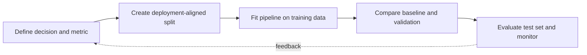

> **Level 3: Advanced** · Topic 23 of 40

[← PySpark](./22-pyspark.md) · [↑ Level index](../README.md) · [Deep Learning →](./24-deep-learning.md)

# Machine Learning

## Overview
- **What is it?** Machine learning estimates patterns from data and evaluates whether those patterns generalize to unseen examples under a defined objective.
- **Why is it important?** A sound workflow prevents leakage, establishes baselines, uses suitable metrics, and packages preprocessing with the estimator.
- **Where is it used?** It supports classification, regression, ranking, forecasting, anomaly detection, and decision support.

## Learning Objectives
- Split data according to deployment reality and prevent target leakage.
- Build scikit-learn preprocessing and estimator pipelines.
- Evaluate baselines, cross-validation variance, calibration, and error slices.

## Real World Applications
- Predicting churn, demand, risk, quality, or response propensity.
- Ranking candidates and detecting unusual behavior for human review.
- Automating repeatable model training and evaluation with stored metadata.

## Core Concepts

### Generalization and Leakage
- **Definition:** Generalization is performance on future data; leakage occurs when training features or preprocessing use information unavailable at prediction time.
- **Visual explanation:** `raw historical data → deployment-aligned split → fit only on train → evaluate`
- **Practical example:**

```python
from sklearn.model_selection import train_test_split

X_train, X_test, y_train, y_test = train_test_split(
    features,
    target,
    test_size=0.2,
    random_state=42,
    stratify=target,
)
```

### Pipelines and Preprocessing
- **Definition:** A scikit-learn Pipeline fits each preprocessing step only on training folds and applies the same transformation sequence during prediction.
- **Visual explanation:** `raw features → fitted transformer → estimator → prediction`
- **Practical example:**

```python
from sklearn.impute import SimpleImputer
from sklearn.linear_model import LogisticRegression
from sklearn.pipeline import make_pipeline
from sklearn.preprocessing import StandardScaler

model = make_pipeline(
    SimpleImputer(),
    StandardScaler(),
    LogisticRegression(max_iter=1_000),
)
```

### Evaluation and Uncertainty
- **Definition:** Metrics must reflect decision costs and class balance; cross-validation estimates variability but does not replace a final untouched test set.
- **Visual explanation:** `baseline → cross-validation distribution → test metric → slice errors`
- **Practical example:**

```python
from sklearn.model_selection import cross_validate

scores = cross_validate(
    model,
    features,
    target,
    cv=5,
    scoring=["roc_auc", "neg_log_loss"],
)
```

## Infographic Summary

| Infographic Block | Topic-specific takeaway |
| --- | --- |
| 📌 Concept | Machine learning estimates patterns from data and evaluates whether those patterns generalize to unseen examples under a defined objective. |
| ⚡ Purpose | A sound workflow prevents leakage, establishes baselines, uses suitable metrics, and packages preprocessing with the estimator. |
| 🔥 Benefits | Builds the ability to split data according to deployment reality and prevent target leakage; it also helps practitioners build scikit-learn preprocessing and estimator pipelines. |
| 🎯 Use Cases | Predicting churn, demand, risk, quality, or response propensity. Ranking candidates and detecting unusual behavior for human review. |
| 🚀 Best Practices | Inspect errors by meaningful cohorts, not only one aggregate. |
| ❌ Common Mistakes | Ignoring the guardrail “Monitor feature drift and outcome quality after deployment”. |

## Syntax Guide

### Basic Syntax

```python
from sklearn.dummy import DummyClassifier

baseline = DummyClassifier(strategy="prior")
baseline.fit(X_train, y_train)
```

### Standard Structure

```python
model.fit(X_train, y_train)
probabilities = model.predict_proba(X_test)[:, 1]
```

### Code Pattern

```python
from sklearn.metrics import classification_report, roc_auc_score

predictions = model.predict(X_test)
print(classification_report(y_test, predictions))
auc = roc_auc_score(y_test, probabilities)
```

## Examples

### Beginner Example

```python
from sklearn.datasets import load_iris
from sklearn.linear_model import LogisticRegression

X, y = load_iris(return_X_y=True)
classifier = LogisticRegression(max_iter=1_000).fit(X, y)
print(classifier.predict(X[:2]))
```

### Intermediate Example

```python
from sklearn.datasets import load_breast_cancer
from sklearn.model_selection import cross_val_score
from sklearn.pipeline import make_pipeline
from sklearn.preprocessing import StandardScaler
from sklearn.linear_model import LogisticRegression

X, y = load_breast_cancer(return_X_y=True)
pipeline = make_pipeline(StandardScaler(), LogisticRegression(max_iter=1_000))
print(cross_val_score(pipeline, X, y, cv=5, scoring="roc_auc").mean())
```

### Advanced Example

```python
from sklearn.compose import ColumnTransformer
from sklearn.impute import SimpleImputer
from sklearn.pipeline import make_pipeline
from sklearn.preprocessing import OneHotEncoder, StandardScaler

numeric = make_pipeline(SimpleImputer(strategy="median"), StandardScaler())
categorical = make_pipeline(
    SimpleImputer(strategy="most_frequent"),
    OneHotEncoder(handle_unknown="ignore"),
)
preprocessing = ColumnTransformer([
    ("numeric", numeric, ["age", "income"]),
    ("categorical", categorical, ["region"]),
])
production_model = make_pipeline(
    preprocessing,
    LogisticRegression(max_iter=1_000),
)
```

## Workflow Diagram



---

[← PySpark](./22-pyspark.md) · [↑ Level index](../README.md) · [Deep Learning →](./24-deep-learning.md)
