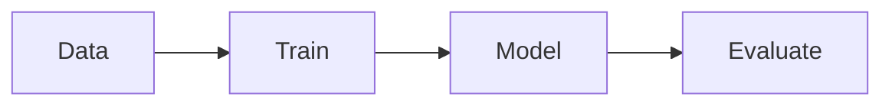

# Machine Learning

## Overview

- **What is it?** Machine learning trains models to make predictions from data without explicit rules.
- **Why is it important?** Predictive models automate decisions in ranking, fraud, and forecasting.
- **Where is it used?** Recommendations, credit risk, demand forecast, churn prediction.

## Learning Objectives

- **Skills gained:** Practical command of Machine Learning.
- **Concepts covered:**

- Split train/test data.
- Train baseline models with scikit-learn.
- Evaluate with proper metrics.

- **Expected outcome:** You build and evaluate supervised learning baselines.

## Real World Applications

- E-commerce
- Fintech
- Healthcare analytics
- Marketing

- **Business applications:** Automate workflows, reduce manual errors, accelerate delivery.
- **Career relevance:** Required knowledge for Python roles from junior developer to senior engineer.

## Core Concepts

### Features/labels

- **Definition:** X and y for supervised learning.
- **Visual explanation:** `Features/labels` → process → result
- **Practical example:**

```python
X = [[1], [2]]
y = [0, 1]
print(len(X) == len(y))
```

### train/test split

- **Definition:** Holdout evaluation.
- **Visual explanation:** `train/test split` → process → result
- **Practical example:**

```python
data = list(range(10))
train, test = data[:8], data[8:]
print(len(test))
```

### metrics

- **Definition:** Measure performance.
- **Visual explanation:** `metrics` → process → result
- **Practical example:**

```python
def accuracy(y_true, y_pred):
    return sum(a == b for a, b in zip(y_true, y_pred)) / len(y_true)
print(accuracy([1, 0], [1, 0]))
```

## Infographic Summary

| Block | Summary |
| --- | --- |
| 📌 Concept | ML generalizes patterns from data to unseen examples. |
| ⚡ Purpose | Automate prediction and classification. |
| 🔥 Benefits | Handles complex patterns, improves with data. |
| 🎯 Use Cases | Spam detection, pricing, recommendations. |
| 🚀 Best Practices | Cross-validation; feature scaling; address leakage; track experiments. |
| ❌ Common Mistakes | Testing on training data, ignoring class imbalance, no baseline. |

## Syntax Guide

### Basic Syntax

```python
model.fit(X_train, y_train)
preds = model.predict(X_test)
```

### Standard Structure

```python
prepare -> train -> evaluate -> deploy
```

### Code Pattern

```python
Pipeline([('scale', scaler), ('clf', model)])
```

## Examples

### Beginner Example

```python
xs = [1, 2, 3]
ys = [2, 4, 6]
print(all(y == x * 2 for x, y in zip(xs, ys)))
```

### Intermediate Example

```python
from statistics import mean

def mse(y_true, y_pred):
    return mean((a - b) ** 2 for a, b in zip(y_true, y_pred))


print(round(mse([1.0, 2.0], [1.1, 1.9]), 3))
```

### Advanced Example

```python
def kfold_indices(n, k=3):
    fold_size = n // k
    for i in range(k):
        start = i * fold_size
        end = (i + 1) * fold_size if i < k - 1 else n
        val_idx = list(range(start, end))
        train_idx = [j for j in range(n) if j not in val_idx]
        yield train_idx, val_idx


print(next(kfold_indices(9))[0][:3])
```

## Workflow Diagram



---
