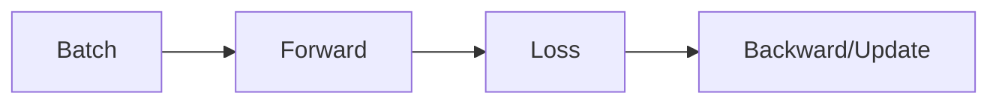

# Deep Learning

## Overview

- **What is it?** Deep learning uses neural networks with many layers to learn hierarchical representations.
- **Why is it important?** It achieves state-of-the-art results in vision, speech, and language tasks.
- **Where is it used?** Computer vision, NLP, speech, generative AI, recommender systems.

## Learning Objectives

- **Skills gained:** Practical command of Deep Learning.
- **Concepts covered:**

- Understand tensors, layers, and loss functions.
- Train with PyTorch or TensorFlow basics.
- Monitor overfitting with validation.

- **Expected outcome:** You train simple neural networks and interpret training loops.

## Real World Applications

- AI products
- Autonomous systems
- Media
- Healthcare imaging

- **Business applications:** Automate workflows, reduce manual errors, accelerate delivery.
- **Career relevance:** Required knowledge for Python roles from junior developer to senior engineer.

## Core Concepts

### Tensor

- **Definition:** Multi-dimensional array for DL.
- **Visual explanation:** `Tensor` → process → result
- **Practical example:**

```python
import numpy as np
x = np.zeros((2, 3))
print(x.shape)
```

### Layer

- **Definition:** Learnable transformation.
- **Visual explanation:** `Layer` → process → result
- **Practical example:**

```python
weights = [0.5, -0.2]
print(len(weights))
```

### Loss

- **Definition:** Objective to minimize.
- **Visual explanation:** `Loss` → process → result
- **Practical example:**

```python
def mse(y, y_hat):
    return ((y - y_hat) ** 2).mean()
import numpy as np
print(float(mse(np.array([1.0]), np.array([0.5]))))
```

## Infographic Summary

| Block | Summary |
| --- | --- |
| 📌 Concept | Networks compose nonlinear layers trained by gradient descent. |
| ⚡ Purpose | Learn complex patterns from raw or engineered features. |
| 🔥 Benefits | Automatic feature learning, SOTA on many tasks. |
| 🎯 Use Cases | Image classifiers, translators, voice assistants. |
| 🚀 Best Practices | Normalize inputs; early stopping; reproducible seeds; GPU when needed. |
| ❌ Common Mistakes | No validation, wrong loss for task, exploding gradients unhandled. |

## Syntax Guide

### Basic Syntax

```python
for epoch in range(epochs):
    loss = train_step(batch)
    val_loss = eval_step(val_batch)
```

### Standard Structure

```python
data -> model -> loss -> optimizer step -> evaluate
```

### Code Pattern

```python
logits = model(x); loss = criterion(logits, y)
```

## Examples

### Beginner Example

```python
import math
print(round(math.tanh(0.5), 3))
```

### Intermediate Example

```python
import numpy as np

def sigmoid(x):
    return 1 / (1 + np.exp(-x))

def forward(x, w, b):
    return sigmoid(x * w + b)

print(round(float(forward(1.0, 0.5, 0.0)), 3))
```

### Advanced Example

```python
import numpy as np

def train_step(w, x, y, lr=0.1):
    pred = w * x
    loss = (pred - y) ** 2
    grad = 2 * (pred - y) * x
    w -= lr * grad
    return w, float(loss)


w = 0.0
for _ in range(5):
    w, loss = train_step(w, 2.0, 6.0)
print(round(w, 3))
```

## Workflow Diagram



---
