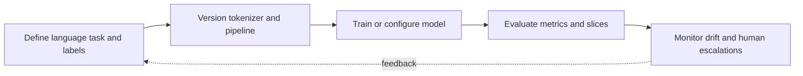

> **Level 3: Advanced** · Topic 25 of 40

[← Deep Learning](./24-deep-learning.md) · [↑ Level index](../README.md) · [Computer Vision →](./26-computer-vision.md)

# NLP

## Overview
- **What is it?** Natural language processing represents, analyzes, and generates human language using linguistic pipelines, statistical models, and pretrained transformers.
- **Why is it important?** Robust NLP keeps tokenization and model versions aligned, handles language and domain variation, and evaluates task-specific errors rather than demos alone.
- **Where is it used?** It supports search, extraction, classification, moderation, summarization, translation, and conversational systems.

## Learning Objectives
- Use spaCy-style pipelines for tokenization, entities, and custom components.
- Use Hugging Face tokenizer/model patterns with truncation and batching.
- Evaluate NLP systems for domain shift, label ambiguity, and harmful bias.

## Real World Applications
- Extracting entities and relationships from documents.
- Classifying support requests and routing them to workflows.
- Semantic search and summarization with documented human review.

## Core Concepts

### Linguistic Pipelines
- **Definition:** An NLP pipeline tokenizes text into a document and applies ordered components such as tagging, parsing, entity recognition, or custom rules.
- **Visual explanation:** `text → tokenizer → ordered components → annotated document`
- **Practical example:**

```python
import spacy

nlp = spacy.blank("en")
ruler = nlp.add_pipe("entity_ruler")
ruler.add_patterns([{"label": "LANGUAGE", "pattern": "Python"}])
document = nlp("Python powers this curriculum.")
entities = [(entity.text, entity.label_) for entity in document.ents]
```

### Transformer Inputs
- **Definition:** A pretrained tokenizer converts text to bounded token IDs and attention masks that must match the model checkpoint and batch shape.
- **Visual explanation:** `texts → checkpoint tokenizer → padded tensors → transformer logits`
- **Practical example:**

```python
from transformers import AutoTokenizer

tokenizer = AutoTokenizer.from_pretrained("distilbert-base-uncased")
batch = tokenizer(
    ["clear documentation", "ambiguous requirement"],
    padding=True,
    truncation=True,
    return_tensors="pt",
)
```

### Task Evaluation
- **Definition:** Evaluation uses label-aware metrics, representative slices, and error review because token overlap or aggregate accuracy can hide systematic failures.
- **Visual explanation:** `held-out examples → predictions → per-label metrics → qualitative error slices`
- **Practical example:**

```python
from sklearn.metrics import classification_report

expected = ["billing", "technical", "billing"]
predicted = ["billing", "billing", "billing"]
report = classification_report(expected, predicted, zero_division=0)
print(report)
```

## Infographic Summary

| Infographic Block | Topic-specific takeaway |
| --- | --- |
| 📌 Concept | Natural language processing represents, analyzes, and generates human language using linguistic pipelines, statistical models, and pretrained transformers. |
| ⚡ Purpose | Robust NLP keeps tokenization and model versions aligned, handles language and domain variation, and evaluates task-specific errors rather than demos alone. |
| 🔥 Benefits | Builds the ability to use spaCy-style pipelines for tokenization, entities, and custom components; it also helps practitioners use Hugging Face tokenizer/model patterns with truncation and batching. |
| 🎯 Use Cases | Extracting entities and relationships from documents. Classifying support requests and routing them to workflows. |
| 🚀 Best Practices | Report per-label precision, recall, and representative error slices. |
| ❌ Common Mistakes | Ignoring the guardrail “Review privacy, bias, prompt injection, and human escalation needs”. |

## Syntax Guide

### Basic Syntax

```python
import spacy

nlp = spacy.blank("en")
doc = nlp("Tokenize this sentence.")
tokens = [token.text for token in doc]
```

### Standard Structure

```python
from transformers import pipeline

classifier = pipeline(
    "sentiment-analysis",
    model="distilbert/distilbert-base-uncased-finetuned-sst-2-english",
)
result = classifier("The API is reliable.")
```

### Code Pattern

```python
import spacy
from spacy.language import Language

@Language.component("character_count")
def character_count(doc):
    doc.user_data["characters"] = len(doc.text)
    return doc

nlp = spacy.blank("en")
nlp.add_pipe("character_count")
```

## Examples

### Beginner Example

```python
import re

words = re.findall(r"\b[\w'-]+\b", "Python's tokenizer baseline.", flags=re.UNICODE)
print(words)
```

### Intermediate Example

```python
import spacy

nlp = spacy.blank("en")
ruler = nlp.add_pipe("sentencizer")
doc = nlp("First sentence. Second sentence.")
print([sentence.text for sentence in doc.sents])
```

### Advanced Example

```python
import torch
from transformers import AutoModelForSequenceClassification, AutoTokenizer

checkpoint = "distilbert/distilbert-base-uncased-finetuned-sst-2-english"
tokenizer = AutoTokenizer.from_pretrained(checkpoint)
model = AutoModelForSequenceClassification.from_pretrained(checkpoint)
encoded = tokenizer(["reliable", "broken"], padding=True, return_tensors="pt")
with torch.inference_mode():
    probabilities = model(**encoded).logits.softmax(dim=-1)
print(probabilities)
```

## Workflow Diagram



---

[← Deep Learning](./24-deep-learning.md) · [↑ Level index](../README.md) · [Computer Vision →](./26-computer-vision.md)
