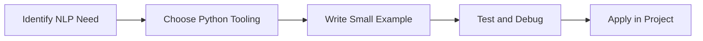

> **Level 3: Advanced** · Topic 25 of 40

[← Deep Learning](./24-deep-learning.md) · [↑ Level index](../README.md) · [Computer Vision →](./26-computer-vision.md)

# NLP

## Overview
- **What is it?** NLP is a Python knowledge area focused on AI engineering.
- **Why is it important?** Help developers apply AI engineering techniques safely, clearly, and consistently.
- **Where is it used?** Predictive products, language systems, vision applications, and model-powered automation.

## Learning Objectives
- Gain the practical skill to explain, write, debug, and review nlp code.
- Cover the vocabulary, syntax, workflow, edge cases, and professional habits behind nlp.
- Expected outcome: you can use nlp in a small project and recognize when it belongs in production code.

## Real World Applications
- **Industry use cases:** Predictive products, language systems, vision applications, and model-powered automation.
- **Business applications:** Reduce manual work, improve reliability, support reporting, automate decisions, and ship maintainable features.
- **Career relevance:** Supports Python developer, backend engineer, data engineer, AI engineer, DevOps engineer, QA automation, and cybersecurity automation roles.

## Core Concepts

### Dataset Representation
- **Definition:** The main idea that gives nlp its structure and purpose inside a Python program.
- **Visual explanation:** `problem -> NLP model -> clear code`
- **Practical example:**

```python
apply_nlp_label = "NLP"
print(apply_nlp_label)
```

### Transformation Pipeline
- **Definition:** The ordered steps Python follows when nlp code is created, executed, or integrated.
- **Visual explanation:** `input -> Python operation -> result -> feedback`
- **Practical example:**

```python
import re
print(bool(re.search(r"python", "learn python")))
```

### Validation Signal
- **Definition:** The reliability habit that keeps nlp understandable, testable, secure, and maintainable.
- **Visual explanation:** `working code -> validation -> production confidence`
- **Practical example:**

```python
import re

emails = re.findall(r"[\w.-]+@[\w.-]+", "Contact a@x.com and b@y.com")
print(emails)
```

## Infographic Summary

| Infographic Block | Key Message |
| --- | --- |
| 📌 Concept | NLP belongs to the AI engineering part of Python mastery. |
| ⚡ Purpose | Help developers apply AI engineering techniques safely, clearly, and consistently. |
| 🔥 Benefits | Stronger maintainability, better reliability, and more professional AI engineering decisions. |
| 🎯 Use Cases | Predictive products, language systems, vision applications, and model-powered automation. |
| 🚀 Best Practices | Prefer readable names, small examples, explicit errors, tests, documentation, and version-aware choices. |
| ❌ Common Mistakes | Copying code without understanding it, ignoring edge cases, skipping validation, and mixing unrelated responsibilities. |

## Syntax Guide

### Basic Syntax

```python
import re
match = re.search(r"\d+", "Order 42")
```

### Standard Structure

```python
def apply_nlp(value):
    """Apply the NLP concept to one value."""
    return value

result = apply_nlp("practice")
print(result)
```

### Code Pattern

```python
# 1. Identify the NLP problem
# 2. Apply the correct Python structure
# 3. Validate the result with tests or output
```

## Examples

### Beginner Example

```python
import re
print(bool(re.search(r"python", "learn python")))
```

### Intermediate Example

```python
import re

emails = re.findall(r"[\w.-]+@[\w.-]+", "Contact a@x.com and b@y.com")
print(emails)
```

### Advanced Example

```python
import re

pattern = re.compile(r"(?P<status>\d{3}) (?P<path>/\S+)")
match = pattern.search("200 /api/users")
print(match.groupdict() if match else {})
```

## Workflow Diagram




---

---

[← Deep Learning](./24-deep-learning.md) · [↑ Level index](../README.md) · [Computer Vision →](./26-computer-vision.md)
