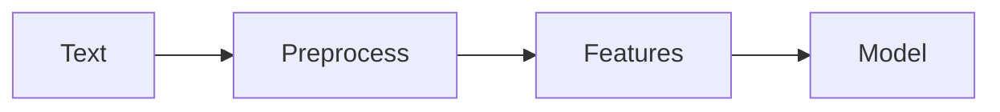

# NLP

## Overview

- **What is it?** Natural Language Processing analyzes and generates human language text.
- **Why is it important?** Text dominates business communication, support, and web content.
- **Where is it used?** Chatbots, search, sentiment, translation, document classification.

## Learning Objectives

- **Skills gained:** Practical command of NLP.
- **Concepts covered:**

- Tokenize and normalize text.
- Build bag-of-words or embedding features.
- Evaluate NLP classifiers.

- **Expected outcome:** You preprocess text and train baseline NLP models.

## Real World Applications

- Customer support
- Legal tech
- Social analytics
- Edtech

- **Business applications:** Automate workflows, reduce manual errors, accelerate delivery.
- **Career relevance:** Required knowledge for Python roles from junior developer to senior engineer.

## Core Concepts

### Tokenization

- **Definition:** Split text into tokens.
- **Visual explanation:** `Tokenization` → process → result
- **Practical example:**

```python
text = 'Hello world'
print(text.lower().split())
```

### Stop words

- **Definition:** Filter common tokens.
- **Visual explanation:** `Stop words` → process → result
- **Practical example:**

```python
stop = {'the', 'a'}
tokens = ['the', 'cat']
print([t for t in tokens if t not in stop])
```

### Embeddings

- **Definition:** Dense word vectors.
- **Visual explanation:** `Embeddings` → process → result
- **Practical example:**

```python
vec = {'python': [0.1, 0.2]}
print(len(vec['python']))
```

## Infographic Summary

| Block | Summary |
| --- | --- |
| 📌 Concept | NLP pipelines turn raw text into numeric features. |
| ⚡ Purpose | Extract meaning and structure from language. |
| 🔥 Benefits | Automation of text-heavy workflows. |
| 🎯 Use Cases | Ticket routing, spam filters, entity extraction. |
| 🚀 Best Practices | Handle unicode; domain-specific tokenization; evaluate per class. |
| ❌ Common Mistakes | Naive stemming for all languages, train/test leakage via duplicates. |

## Syntax Guide

### Basic Syntax

```python
tokens = text.lower().split()
features = Counter(tokens)
```

### Standard Structure

```python
normalize -> tokenize -> featurize -> model
```

### Code Pattern

```python
clean(text) -> vectorize -> clf.predict
```

## Examples

### Beginner Example

```python
review = 'I love this product'
print('love' in review)
```

### Intermediate Example

```python
from collections import Counter

def bow(tokens):
    return Counter(tokens)


print(bow(['python', 'is', 'fun', 'python']))
```

### Advanced Example

```python
import re

def extract_mentions(text: str) -> list[str]:
    return re.findall(r'@([A-Za-z0-9_]+)', text)


print(extract_mentions('hi @ada and @lin'))
```

## Workflow Diagram



---
