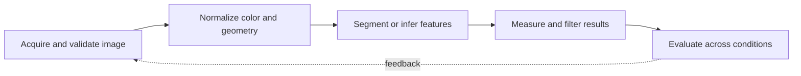

> **Level 3: Advanced** · Topic 26 of 40

[← NLP](./25-nlp.md) · [↑ Level index](../README.md) · [FastAPI →](./27-fastapi.md)

# Computer Vision

## Overview
- **What is it?** Computer vision converts images or video into measurements and predictions through image geometry, color transforms, filtering, feature extraction, and learned models.
- **Why is it important?** OpenCV arrays require careful handling of BGR channel order, coordinate conventions, dtypes, interpolation, and camera or dataset variation.
- **Where is it used?** It is used in inspection, document processing, robotics, medical imaging, media analysis, and visual search.

## Learning Objectives
- Read, validate, transform, and write images with OpenCV.
- Build reproducible thresholding, morphology, contour, and feature pipelines.
- Evaluate robustness across lighting, scale, viewpoint, and acquisition devices.

## Real World Applications
- Detecting defects and measuring objects on production lines.
- Deskewing, cleaning, and segmenting scanned documents.
- Preparing frames and post-processing outputs for learned vision models.

## Core Concepts

### Image Arrays and Color
- **Definition:** OpenCV represents images as NumPy arrays with height, width, and channels; color images are normally decoded in BGR order.
- **Visual explanation:** `encoded file → BGR ndarray [height,width,channel] → color transform`
- **Practical example:**

```python
import cv2

image = cv2.imread("input.png", cv2.IMREAD_COLOR)
if image is None:
    raise FileNotFoundError("input.png")
rgb = cv2.cvtColor(image, cv2.COLOR_BGR2RGB)
```

### Segmentation and Morphology
- **Definition:** Thresholding separates pixels by intensity, while erosion, dilation, opening, and closing reshape binary regions using a structuring element.
- **Visual explanation:** `gray image → threshold → morphology → connected regions`
- **Practical example:**

```python
import cv2
import numpy as np

gray = np.array([[10, 240], [20, 230]], dtype=np.uint8)
_, mask = cv2.threshold(gray, 0, 255, cv2.THRESH_BINARY + cv2.THRESH_OTSU)
kernel = cv2.getStructuringElement(cv2.MORPH_ELLIPSE, (3, 3))
cleaned = cv2.morphologyEx(mask, cv2.MORPH_OPEN, kernel)
```

### Geometry and Contours
- **Definition:** Contours approximate binary boundaries; their area, bounding box, and moments produce measurements in pixel coordinates.
- **Visual explanation:** `binary mask → contours → filter geometry → annotated measurement`
- **Practical example:**

```python
import cv2

contours, _ = cv2.findContours(mask, cv2.RETR_EXTERNAL, cv2.CHAIN_APPROX_SIMPLE)
boxes = [
    cv2.boundingRect(contour)
    for contour in contours
    if cv2.contourArea(contour) >= 10
]
```

## Infographic Summary

| Infographic Block | Topic-specific takeaway |
| --- | --- |
| 📌 Concept | Computer vision converts images or video into measurements and predictions through image geometry, color transforms, filtering, feature extraction, and learned models. |
| ⚡ Purpose | OpenCV arrays require careful handling of BGR channel order, coordinate conventions, dtypes, interpolation, and camera or dataset variation. |
| 🔥 Benefits | Builds the ability to read, validate, transform, and write images with OpenCV; it also helps practitioners build reproducible thresholding, morphology, contour, and feature pipelines. |
| 🎯 Use Cases | Detecting defects and measuring objects on production lines. Deskewing, cleaning, and segmenting scanned documents. |
| 🚀 Best Practices | Validate image load before accessing shape or pixels. |
| ❌ Common Mistakes | Ignoring the guardrail “Evaluate across acquisition conditions, not one sample frame”. |

## Syntax Guide

### Basic Syntax

```python
import cv2

image = cv2.imread("photo.jpg")
if image is None:
    raise FileNotFoundError("photo.jpg")
height, width = image.shape[:2]
```

### Standard Structure

```python
gray = cv2.cvtColor(image, cv2.COLOR_BGR2GRAY)
blurred = cv2.GaussianBlur(gray, (5, 5), 0)
edges = cv2.Canny(blurred, 50, 150)
```

### Code Pattern

```python
def resize_to_width(image, width: int):
    scale = width / image.shape[1]
    size = (width, round(image.shape[0] * scale))
    return cv2.resize(image, size, interpolation=cv2.INTER_AREA)
```

## Examples

### Beginner Example

```python
import cv2
import numpy as np

image = np.zeros((100, 100, 3), dtype=np.uint8)
cv2.circle(image, (50, 50), 20, (0, 255, 0), thickness=-1)
assert image.shape == (100, 100, 3)
```

### Intermediate Example

```python
import cv2
import numpy as np

gray = np.zeros((120, 120), dtype=np.uint8)
cv2.rectangle(gray, (20, 30), (80, 90), 255, thickness=-1)
contours, _ = cv2.findContours(gray, cv2.RETR_EXTERNAL, cv2.CHAIN_APPROX_SIMPLE)
largest = max(contours, key=cv2.contourArea)
print(cv2.boundingRect(largest))
```

### Advanced Example

```python
import cv2

capture = cv2.VideoCapture("input.mp4")
if not capture.isOpened():
    raise OSError("cannot open video")
try:
    while True:
        ok, frame = capture.read()
        if not ok:
            break
        gray = cv2.cvtColor(frame, cv2.COLOR_BGR2GRAY)
        edges = cv2.Canny(gray, 80, 160)
        print(cv2.countNonZero(edges))
finally:
    capture.release()
```

## Workflow Diagram



---

[← NLP](./25-nlp.md) · [↑ Level index](../README.md) · [FastAPI →](./27-fastapi.md)
