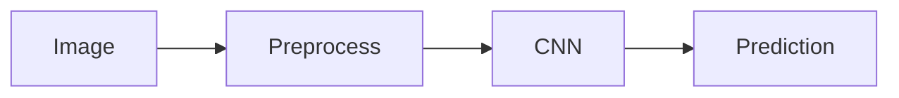

# Computer Vision

## Overview

- **What is it?** Computer vision interprets images and video for detection, classification, and segmentation.
- **Why is it important?** Visual data powers quality inspection, medical imaging, and AR.
- **Where is it used?** Manufacturing QA, radiology assist, autonomous vehicles, retail analytics.

## Learning Objectives

- **Skills gained:** Practical command of Computer Vision.
- **Concepts covered:**

- Load and preprocess image tensors.
- Understand CNN basics.
- Evaluate vision model metrics.

- **Expected outcome:** You run baseline image classification workflows.

## Real World Applications

- Manufacturing
- Healthcare
- Retail
- Security video

- **Business applications:** Automate workflows, reduce manual errors, accelerate delivery.
- **Career relevance:** Required knowledge for Python roles from junior developer to senior engineer.

## Core Concepts

### Image tensor

- **Definition:** HWC or CHW arrays.
- **Visual explanation:** `Image tensor` → process → result
- **Practical example:**

```python
import numpy as np
img = np.zeros((64, 64, 3), dtype=np.uint8)
print(img.shape)
```

### CNN

- **Definition:** Convolution + pooling layers.
- **Visual explanation:** `CNN` → process → result
- **Practical example:**

```python
kernel = [[1, 0], [0, 1]]
print(kernel[0][0])
```

### Augmentation

- **Definition:** Random transforms for robustness.
- **Visual explanation:** `Augmentation` → process → result
- **Practical example:**

```python
import random
print(random.choice(['flip', 'rotate']))
```

## Infographic Summary

| Block | Summary |
| --- | --- |
| 📌 Concept | Conv nets learn spatial hierarchies of visual features. |
| ⚡ Purpose | Automate visual understanding tasks. |
| 🔥 Benefits | Scale beyond manual inspection. |
| 🎯 Use Cases | Defect detection, OCR assist, face blur for privacy. |
| 🚀 Best Practices | Match preprocessing to pretrained models; monitor drift. |
| ❌ Common Mistakes | Wrong normalization, label leakage, ignoring class imbalance. |

## Syntax Guide

### Basic Syntax

```python
image = load_rgb(path)
tensor = preprocess(image)
```

### Standard Structure

```python
load -> augment -> batch -> model -> metrics
```

### Code Pattern

```python
transforms.Compose([Resize, ToTensor, Normalize])
```

## Examples

### Beginner Example

```python
import numpy as np
img = np.array([[0, 255], [128, 64]], dtype=np.uint8)
print(img.mean())
```

### Intermediate Example

```python
import numpy as np

def normalize_image(img: np.ndarray) -> np.ndarray:
    return (img.astype('float32') / 255.0)


arr = np.array([0, 128, 255], dtype=np.uint8)
print(normalize_image(arr).round(2))
```

### Advanced Example

```python
import numpy as np

def conv1d(signal, kernel):
    out = []
    k = len(kernel)
    for i in range(len(signal) - k + 1):
        window = signal[i:i + k]
        out.append(float(np.dot(window, kernel)))
    return out


print(conv1d([1, 2, 3, 4], [1, 0.5]))
```

## Workflow Diagram



---
