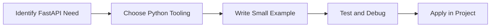

> **Level 3: Advanced** · Topic 27 of 40

[← Computer Vision](./26-computer-vision.md) · [↑ Level index](../README.md) · [Django →](./28-django.md)

# FastAPI

## Overview
- **What is it?** FastAPI is a Python knowledge area focused on integration.
- **Why is it important?** Help developers apply integration techniques safely, clearly, and consistently.
- **Where is it used?** Web services, persistence layers, analytics backends, and business systems.

## Learning Objectives
- Gain the practical skill to explain, write, debug, and review fastapi code.
- Cover the vocabulary, syntax, workflow, edge cases, and professional habits behind fastapi.
- Expected outcome: you can use fastapi in a small project and recognize when it belongs in production code.

## Real World Applications
- **Industry use cases:** Web services, persistence layers, analytics backends, and business systems.
- **Business applications:** Reduce manual work, improve reliability, support reporting, automate decisions, and ship maintainable features.
- **Career relevance:** Supports Python developer, backend engineer, data engineer, AI engineer, DevOps engineer, QA automation, and cybersecurity automation roles.

## Core Concepts

### Contract
- **Definition:** The main idea that gives fastapi its structure and purpose inside a Python program.
- **Visual explanation:** `problem -> FastAPI model -> clear code`
- **Practical example:**

```python
apply_fastapi_label = "FastAPI"
print(apply_fastapi_label)
```

### Connection Flow
- **Definition:** The ordered steps Python follows when fastapi code is created, executed, or integrated.
- **Visual explanation:** `input -> Python operation -> result -> feedback`
- **Practical example:**

```python
from fastapi import FastAPI

app = FastAPI()

@app.get("/")
def root():
    return {"message": "Hello API"}
```

### Reliability Boundary
- **Definition:** The reliability habit that keeps fastapi understandable, testable, secure, and maintainable.
- **Visual explanation:** `working code -> validation -> production confidence`
- **Practical example:**

```python
from pydantic import BaseModel

class UserIn(BaseModel):
    email: str

def create_user(user: UserIn) -> dict[str, str]:
    return {"email": user.email, "status": "created"}

print(create_user(UserIn(email="a@example.com")))
```

## Infographic Summary

| Infographic Block | Key Message |
| --- | --- |
| 📌 Concept | FastAPI belongs to the integration part of Python mastery. |
| ⚡ Purpose | Help developers apply integration techniques safely, clearly, and consistently. |
| 🔥 Benefits | Stronger maintainability, better reliability, and more professional integration decisions. |
| 🎯 Use Cases | Web services, persistence layers, analytics backends, and business systems. |
| 🚀 Best Practices | Prefer readable names, small examples, explicit errors, tests, documentation, and version-aware choices. |
| ❌ Common Mistakes | Copying code without understanding it, ignoring edge cases, skipping validation, and mixing unrelated responsibilities. |

## Syntax Guide

### Basic Syntax

```python
from fastapi import FastAPI
app = FastAPI()

@app.get("/health")
def health():
    return {"ok": True}
```

### Standard Structure

```python
def apply_fastapi(value):
    """Apply the FastAPI concept to one value."""
    return value

result = apply_fastapi("practice")
print(result)
```

### Code Pattern

```python
# 1. Identify the FastAPI problem
# 2. Apply the correct Python structure
# 3. Validate the result with tests or output
```

## Examples

### Beginner Example

```python
from fastapi import FastAPI

app = FastAPI()

@app.get("/")
def root():
    return {"message": "Hello API"}
```

### Intermediate Example

```python
from pydantic import BaseModel

class UserIn(BaseModel):
    email: str

def create_user(user: UserIn) -> dict[str, str]:
    return {"email": user.email, "status": "created"}

print(create_user(UserIn(email="a@example.com")))
```

### Advanced Example

```python
from fastapi import Depends, FastAPI

app = FastAPI()

def get_settings():
    return {"debug": False}

@app.get("/settings")
def settings(settings = Depends(get_settings)):
    return settings
```

## Workflow Diagram




---

---

[← Computer Vision](./26-computer-vision.md) · [↑ Level index](../README.md) · [Django →](./28-django.md)
