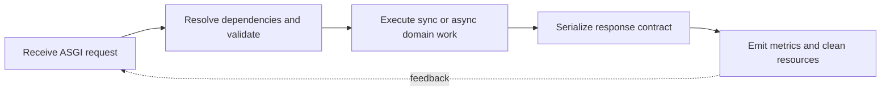

> **Level 3: Advanced** · Topic 27 of 40

[← Computer Vision](./26-computer-vision.md) · [↑ Level index](../README.md) · [Django →](./28-django.md)

# FastAPI

## Overview
- **What is it?** FastAPI is an ASGI framework that derives request validation and OpenAPI schemas from Python type annotations and Pydantic models.
- **Why is it important?** Production APIs require explicit contracts, dependency lifetimes, exception mapping, async-safe I/O, authentication, and observability.
- **Where is it used?** It is used for typed HTTP APIs, model-serving endpoints, internal services, and asynchronous integrations.

## Learning Objectives
- Define FastAPI routes with request, response, path, and dependency models.
- Choose synchronous or asynchronous handlers according to downstream libraries.
- Test contracts and map domain failures to stable HTTP responses.

## Real World Applications
- JSON APIs with generated OpenAPI documentation and client schemas.
- Async endpoints that coordinate databases and remote services.
- Dependency-injected authorization, settings, and request-scoped resources.

## Core Concepts

### Typed API Contracts
- **Definition:** FastAPI reads annotations and Pydantic models to parse inputs, report validation errors, serialize outputs, and generate OpenAPI.
- **Visual explanation:** `HTTP request → validation model → handler → response model`
- **Practical example:**

```python
from fastapi import FastAPI
from pydantic import BaseModel, Field

app = FastAPI()

class ItemIn(BaseModel):
    name: str = Field(min_length=1)
    quantity: int = Field(gt=0)

@app.post("/items", status_code=201)
def create_item(item: ItemIn) -> ItemIn:
    return item
```

### Dependencies and Lifetimes
- **Definition:** `Depends` resolves a dependency graph per request and generator dependencies can safely release resources after the response.
- **Visual explanation:** `route → dependency graph → handler → dependency cleanup`
- **Practical example:**

```python
from collections.abc import Iterator
from fastapi import Depends

def database() -> Iterator[dict[str, str]]:
    connection = {"state": "open"}
    try:
        yield connection
    finally:
        connection["state"] = "closed"

@app.get("/health")
def health(connection = Depends(database)) -> dict[str, str]:
    return {"database": connection["state"]}
```

### Async Boundaries and Errors
- **Definition:** An async route should await nonblocking clients; blocking work belongs in synchronous dependencies or a worker, and domain errors need stable HTTP mapping.
- **Visual explanation:** `request → async I/O or worker boundary → domain result → HTTP mapping`
- **Practical example:**

```python
import asyncio
from fastapi import HTTPException

@app.get("/items/{item_id}")
async def read_item(item_id: int) -> dict[str, int]:
    await asyncio.sleep(0)
    if item_id < 1:
        raise HTTPException(status_code=404, detail="item not found")
    return {"id": item_id}
```

## Infographic Summary

| Infographic Block | Topic-specific takeaway |
| --- | --- |
| 📌 Concept | FastAPI is an ASGI framework that derives request validation and OpenAPI schemas from Python type annotations and Pydantic models. |
| ⚡ Purpose | Production APIs require explicit contracts, dependency lifetimes, exception mapping, async-safe I/O, authentication, and observability. |
| 🔥 Benefits | Builds the ability to define FastAPI routes with request, response, path, and dependency models; it also helps practitioners choose synchronous or asynchronous handlers according to downstream libraries. |
| 🎯 Use Cases | JSON APIs with generated OpenAPI documentation and client schemas. Async endpoints that coordinate databases and remote services. |
| 🚀 Best Practices | Response models prevent accidental field disclosure. |
| ❌ Common Mistakes | Ignoring the guardrail “Do not call blocking SDKs directly inside async routes”. |

## Syntax Guide

### Basic Syntax

```python
from fastapi import FastAPI

app = FastAPI()

@app.get("/")
def root() -> dict[str, str]:
    return {"status": "ready"}
```

### Standard Structure

```python
from pydantic import BaseModel

class ItemOut(BaseModel):
    id: int
    name: str

@app.get("/items/{item_id}", response_model=ItemOut)
def item(item_id: int) -> ItemOut:
    return ItemOut(id=item_id, name="book")
```

### Code Pattern

```python
from typing import Annotated
from fastapi import Depends, Header, HTTPException

def require_token(x_token: Annotated[str | None, Header()] = None) -> str:
    if x_token != "training-token":
        raise HTTPException(status_code=401, detail="invalid token")
    return x_token
```

## Examples

### Beginner Example

```python
from fastapi import FastAPI

app = FastAPI()

@app.get("/greet/{name}")
def greet(name: str) -> dict[str, str]:
    return {"message": f"Hello, {name}"}
```

### Intermediate Example

```python
from fastapi.testclient import TestClient

client = TestClient(app)
response = client.get("/greet/Ada")
assert response.status_code == 200
assert response.json() == {"message": "Hello, Ada"}
```

### Advanced Example

```python
from contextlib import asynccontextmanager
from fastapi import FastAPI

@asynccontextmanager
async def lifespan(application: FastAPI):
    application.state.ready = True
    yield
    application.state.ready = False

service = FastAPI(lifespan=lifespan)

@service.get("/ready")
async def ready() -> dict[str, bool]:
    return {"ready": service.state.ready}
```

## Workflow Diagram



---

[← Computer Vision](./26-computer-vision.md) · [↑ Level index](../README.md) · [Django →](./28-django.md)
