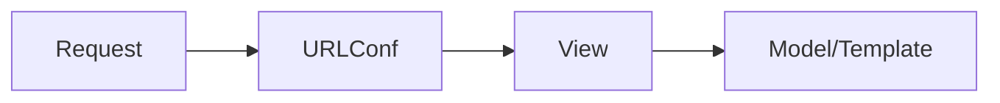

# Django

## Overview

- **What is it?** Django is a batteries-included web framework for rapid secure web development.
- **Why is it important?** It provides ORM, admin, auth, and routing out of the box.
- **Where is it used?** Content sites, admin-heavy apps, MVPs, internal portals.

## Learning Objectives

- **Skills gained:** Practical command of Django.
- **Concepts covered:**

- Create projects, apps, models, and views.
- Use Django ORM and migrations.
- Configure URLs and templates.

- **Expected outcome:** You build full-stack web apps with Django conventions.

## Real World Applications

- News sites
- SaaS admin
- Education portals
- Marketplaces

- **Business applications:** Automate workflows, reduce manual errors, accelerate delivery.
- **Career relevance:** Required knowledge for Python roles from junior developer to senior engineer.

## Core Concepts

### MTV

- **Definition:** Model-Template-View pattern.
- **Visual explanation:** `MTV` → process → result
- **Practical example:**

```python
MODEL = {'fields': ['title']}
print(MODEL['fields'])
```

### ORM

- **Definition:** Database abstraction.
- **Visual explanation:** `ORM` → process → result
- **Practical example:**

```python
class Row:
    def __init__(self, title):
        self.title = title
print(Row('hi').title)
```

### Admin

- **Definition:** Auto CRUD UI.
- **Visual explanation:** `Admin` → process → result
- **Practical example:**

```python
ADMIN = {'register': True}
print(ADMIN['register'])
```

## Infographic Summary

| Block | Summary |
| --- | --- |
| 📌 Concept | Django favors convention and integrated components. |
| ⚡ Purpose | Ship secure web apps quickly. |
| 🔥 Benefits | Mature ecosystem, built-in auth/admin, ORM. |
| 🎯 Use Cases | CMS, membership sites, internal tools. |
| 🚀 Best Practices | Use CBVs/FBVs appropriately; split settings per env; cache queries. |
| ❌ Common Mistakes | Fat views, N+1 queries, raw SQL without need. |

## Syntax Guide

### Basic Syntax

```python
urlpatterns = [path('health/', health_view)]
```

### Standard Structure

```python
project -> apps -> models -> views -> urls
```

### Code Pattern

```python
Model -> Serializer/Form -> View -> Template/JSON
```

## Examples

### Beginner Example

```python
def hello(request):
    return {'message': 'hi'}
```

### Intermediate Example

```python
class Article:
    objects = [{'title': 'Hello', 'published': True}]

    @classmethod
    def published(cls):
        return [a for a in cls.objects if a['published']]


print(Article.published()[0]['title'])
```

### Advanced Example

```python
class QuerySet:
    def __init__(self, rows):
        self.rows = rows

    def filter(self, **kwargs):
        return QuerySet([r for r in self.rows if all(r.get(k) == v for k, v in kwargs.items())])


qs = QuerySet([{'active': True, 'id': 1}, {'active': False, 'id': 2}])
print(qs.filter(active=True).rows[0]['id'])
```

## Workflow Diagram



---
