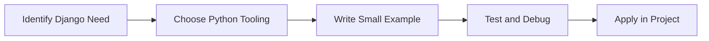

> **Level 3: Advanced** · Topic 28 of 40

[← FastAPI](./27-fastapi.md) · [↑ Level index](../README.md) · [Flask →](./29-flask.md)

# Django

## Overview
- **What is it?** Django is a Python knowledge area focused on web application engineering.
- **Why is it important?** Help developers apply web application engineering techniques safely, clearly, and consistently.
- **Where is it used?** Apis, saas platforms, internal tools, and microservice ecosystems.

## Learning Objectives
- Gain the practical skill to explain, write, debug, and review django code.
- Cover the vocabulary, syntax, workflow, edge cases, and professional habits behind django.
- Expected outcome: you can use django in a small project and recognize when it belongs in production code.

## Real World Applications
- **Industry use cases:** Apis, saas platforms, internal tools, and microservice ecosystems.
- **Business applications:** Reduce manual work, improve reliability, support reporting, automate decisions, and ship maintainable features.
- **Career relevance:** Supports Python developer, backend engineer, data engineer, AI engineer, DevOps engineer, QA automation, and cybersecurity automation roles.

## Core Concepts

### Mental Model
- **Definition:** The main idea that gives django its structure and purpose inside a Python program.
- **Visual explanation:** `problem -> Django model -> clear code`
- **Practical example:**

```python
apply_django_label = "Django"
print(apply_django_label)
```

### Execution Flow
- **Definition:** The ordered steps Python follows when django code is created, executed, or integrated.
- **Visual explanation:** `input -> Python operation -> result -> feedback`
- **Practical example:**

```python
from fastapi import FastAPI

app = FastAPI()

@app.get("/")
def root():
    return {"message": "Hello API"}
```

### Quality Rule
- **Definition:** The reliability habit that keeps django understandable, testable, secure, and maintainable.
- **Visual explanation:** `working code -> validation -> production confidence`
- **Practical example:**

```python
from pydantic import BaseModel

class UserIn(BaseModel):
    email: str

def create_user(user: UserIn) -> dict[str, str]:
    return {"email": user.email, "status": "created"}

print(create_user(UserIn(email="a@example.com")))
```

## Infographic Summary

| Infographic Block | Key Message |
| --- | --- |
| 📌 Concept | Django belongs to the web application engineering part of Python mastery. |
| ⚡ Purpose | Help developers apply web application engineering techniques safely, clearly, and consistently. |
| 🔥 Benefits | Stronger maintainability, better reliability, and more professional web application engineering decisions. |
| 🎯 Use Cases | Apis, saas platforms, internal tools, and microservice ecosystems. |
| 🚀 Best Practices | Prefer readable names, small examples, explicit errors, tests, documentation, and version-aware choices. |
| ❌ Common Mistakes | Copying code without understanding it, ignoring edge cases, skipping validation, and mixing unrelated responsibilities. |

## Syntax Guide

### Basic Syntax

```python
from fastapi import FastAPI
app = FastAPI()

@app.get("/health")
def health():
    return {"ok": True}
```

### Standard Structure

```python
def apply_django(value):
    """Apply the Django concept to one value."""
    return value

result = apply_django("practice")
print(result)
```

### Code Pattern

```python
# 1. Identify the Django problem
# 2. Apply the correct Python structure
# 3. Validate the result with tests or output
```

## Examples

### Beginner Example

```python
from fastapi import FastAPI

app = FastAPI()

@app.get("/")
def root():
    return {"message": "Hello API"}
```

### Intermediate Example

```python
from pydantic import BaseModel

class UserIn(BaseModel):
    email: str

def create_user(user: UserIn) -> dict[str, str]:
    return {"email": user.email, "status": "created"}

print(create_user(UserIn(email="a@example.com")))
```

### Advanced Example

```python
from fastapi import Depends, FastAPI

app = FastAPI()

def get_settings():
    return {"debug": False}

@app.get("/settings")
def settings(settings = Depends(get_settings)):
    return settings
```

## Workflow Diagram




---

---

[← FastAPI](./27-fastapi.md) · [↑ Level index](../README.md) · [Flask →](./29-flask.md)
