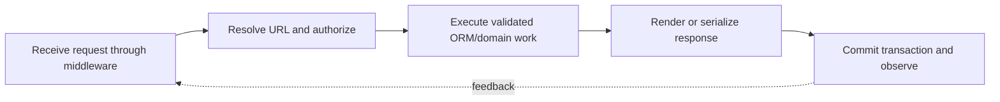

> **Level 3: Advanced** · Topic 28 of 40

[← FastAPI](./27-fastapi.md) · [↑ Level index](../README.md) · [Flask →](./29-flask.md)

# Django

## Overview
- **What is it?** Django is a batteries-included web framework with an ORM, URL routing, templates, forms, authentication, migrations, middleware, and administrative tooling.
- **Why is it important?** Its request lifecycle and conventions support cohesive server-rendered applications and APIs, but database boundaries and query behavior must remain explicit.
- **Where is it used?** It is used for content systems, marketplaces, internal platforms, and data-backed business applications.

## Learning Objectives
- Define Django models, queries, views, URLs, forms, and transactions.
- Prevent N+1 queries and enforce constraints at the database boundary.
- Apply middleware, authentication, CSRF protection, and settings conventions.

## Real World Applications
- Data-backed sites with administrative workflows and authentication.
- Transactional business systems with relational models and migrations.
- Server-rendered interfaces or APIs sharing one domain and ORM.

## Core Concepts

### Models and Migrations
- **Definition:** A Django model declares application-level fields and database constraints; migrations version schema changes separately from runtime model code.
- **Visual explanation:** `model declaration → migration operations → database schema`
- **Practical example:**

```python
from django.db import models

class Article(models.Model):
    slug = models.SlugField(unique=True)
    title = models.CharField(max_length=200)
    published_at = models.DateTimeField(null=True, blank=True)

    class Meta:
        ordering = ["-published_at"]
```

### Request Routing and Views
- **Definition:** The URL resolver matches a path to a view, which validates request state, invokes domain or ORM work, and returns an HttpResponse.
- **Visual explanation:** `WSGI/ASGI request → middleware → URL resolver → view → response`
- **Practical example:**

```python
from django.http import JsonResponse
from django.urls import path

def health(request):
    return JsonResponse({"status": "ready"})

urlpatterns = [path("health/", health, name="health")]
```

### QuerySets and Transactions
- **Definition:** QuerySets are lazy database queries; eager relationship loading and `transaction.atomic` control query count and all-or-nothing writes.
- **Visual explanation:** `lazy QuerySet → optimized SQL → atomic commit or rollback`
- **Practical example:**

```python
from django.db import transaction

@transaction.atomic
def publish(article: Article) -> None:
    from django.utils import timezone

    article.published_at = timezone.now()
    article.save(update_fields=["published_at"])
```

## Infographic Summary

| Infographic Block | Topic-specific takeaway |
| --- | --- |
| 📌 Concept | Django is a batteries-included web framework with an ORM, URL routing, templates, forms, authentication, migrations, middleware, and administrative tooling. |
| ⚡ Purpose | Its request lifecycle and conventions support cohesive server-rendered applications and APIs, but database boundaries and query behavior must remain explicit. |
| 🔥 Benefits | Builds the ability to define Django models, queries, views, URLs, forms, and transactions; it also helps practitioners prevent N+1 queries and enforce constraints at the database boundary. |
| 🎯 Use Cases | Data-backed sites with administrative workflows and authentication. Transactional business systems with relational models and migrations. |
| 🚀 Best Practices | Database constraints defend invariants under concurrency. |
| ❌ Common Mistakes | Ignoring the guardrail “Keep secrets outside settings modules and preserve CSRF protection”. |

## Syntax Guide

### Basic Syntax

```python
from django.db import models

class Tag(models.Model):
    name = models.CharField(max_length=80, unique=True)
```

### Standard Structure

```python
articles = (
    Article.objects.filter(published_at__isnull=False)
    .only("slug", "title", "published_at")
    .order_by("-published_at")
)
```

### Code Pattern

```python
from django.views.decorators.http import require_GET
from django.shortcuts import get_object_or_404

@require_GET
def article_detail(request, slug: str):
    article = get_object_or_404(Article, slug=slug)
    return JsonResponse({"slug": article.slug, "title": article.title})
```

## Examples

### Beginner Example

```python
from django.http import HttpResponse

def index(request):
    return HttpResponse("Django ready", content_type="text/plain")
```

### Intermediate Example

```python
from django import forms

class ArticleForm(forms.ModelForm):
    class Meta:
        model = Article
        fields = ["slug", "title"]

    def clean_title(self) -> str:
        return self.cleaned_data["title"].strip()
```

### Advanced Example

```python
from django.db import IntegrityError, transaction

def create_article(slug: str, title: str) -> Article:
    try:
        with transaction.atomic():
            return Article.objects.create(slug=slug, title=title)
    except IntegrityError as error:
        raise ValueError(f"article already exists: {slug}") from error
```

## Workflow Diagram



---

[← FastAPI](./27-fastapi.md) · [↑ Level index](../README.md) · [Flask →](./29-flask.md)
