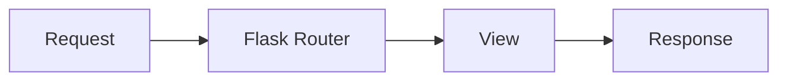

# Flask

## Overview

- **What is it?** Flask is a lightweight WSGI microframework for web apps and APIs.
- **Why is it important?** Minimal core plus extensions fits small services and prototypes.
- **Where is it used?** Micro APIs, webhooks, prototypes, embedded admin UIs.

## Learning Objectives

- **Skills gained:** Practical command of Flask.
- **Concepts covered:**

- Define routes and request handlers.
- Use Jinja templates and blueprints.
- Structure apps with application factory.

- **Expected outcome:** You build small web services with Flask patterns.

## Real World Applications

- Startups
- Internal tools
- IoT dashboards
- Hackathons

- **Business applications:** Automate workflows, reduce manual errors, accelerate delivery.
- **Career relevance:** Required knowledge for Python roles from junior developer to senior engineer.

## Core Concepts

### app.route

- **Definition:** Map URL to view.
- **Visual explanation:** `app.route` → process → result
- **Practical example:**

```python
ROUTES = {}
def route(path):
    def deco(fn):
        ROUTES[path] = fn
        return fn
    return deco
@route('/')
def index():
    return 'ok'
print(ROUTES['/']())
```

### request

- **Definition:** HTTP request context.
- **Visual explanation:** `request` → process → result
- **Practical example:**

```python
class Req:
    args = {'q': 'flask'}
print(Req.args['q'])
```

### Blueprint

- **Definition:** Modular routes.
- **Visual explanation:** `Blueprint` → process → result
- **Practical example:**

```python
BP = {'name': 'api'}
print(BP['name'])
```

## Infographic Summary

| Block | Summary |
| --- | --- |
| 📌 Concept | Flask core stays small; extensions add ORM, auth, etc. |
| ⚡ Purpose | Quick HTTP services with flexibility. |
| 🔥 Benefits | Simple learning curve, huge extension ecosystem. |
| 🎯 Use Cases | Webhooks, minimal APIs, prototypes. |
| 🚀 Best Practices | Application factory; blueprints; config objects; g for request scope. |
| ❌ Common Mistakes | Single-file mega app, debug in prod, global mutable state. |

## Syntax Guide

### Basic Syntax

```python
app = Flask(__name__)
@app.get('/health')
def health(): return {'ok': True}
```

### Standard Structure

```python
app factory -> blueprints -> views -> templates
```

### Code Pattern

```python
register_blueprint(api_bp, url_prefix='/api')
```

## Examples

### Beginner Example

```python
def health():
    return {'status': 'ok'}
print(health())
```

### Intermediate Example

```python
class Flask:
    def __init__(self):
        self.routes = {}

    def route(self, path):
        def decorator(fn):
            self.routes[path] = fn
            return fn
        return decorator


app = Flask()

@app.route('/hello')
def hello():
    return 'hello'


print(app.routes['/hello']())
```

### Advanced Example

```python
class Blueprint:
    def __init__(self, name: str):
        self.name = name
        self.routes = {}

    def route(self, path):
        def decorator(fn):
            self.routes[path] = fn
            return fn
        return decorator


api = Blueprint('api')

@api.route('/items')
def items():
    return ['item']


print(api.routes['/items']())
```

## Workflow Diagram



---
