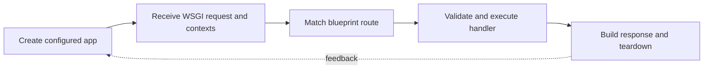

> **Level 3: Advanced** · Topic 29 of 40

[← Django](./28-django.md) · [↑ Level index](../README.md) · [Microservices →](./30-microservices.md)

# Flask

## Overview
- **What is it?** Flask is a focused WSGI web framework that provides routing, request and application contexts, response handling, templates, and extension integration.
- **Why is it important?** Larger Flask systems use an application factory, blueprints, explicit configuration, and scoped resources to avoid global import-time coupling.
- **Where is it used?** It is used for HTTP APIs, server-rendered sites, internal tools, webhooks, and small-to-medium services.

## Learning Objectives
- Build Flask routes, responses, error handlers, and request validation.
- Structure applications with factories, blueprints, and context-scoped resources.
- Test behavior with Flask's test client and isolate configuration.

## Real World Applications
- Compact APIs and webhook receivers with explicit composition.
- Server-rendered internal tools using Jinja templates.
- Modular services assembled from blueprints and extensions.

## Core Concepts

### Application and Request Contexts
- **Definition:** Flask proxies such as `request`, `current_app`, and `g` resolve to context-local objects during an active request or application context.
- **Visual explanation:** `WSGI request → push contexts → view → teardown → pop contexts`
- **Practical example:**

```python
from flask import Flask, current_app

app = Flask(__name__)

@app.get("/name")
def name():
    return {"application": current_app.name}
```

### Application Factory and Blueprints
- **Definition:** A factory builds a configured app instance and registers blueprints, enabling isolated tests and multiple deployments without import-time singleton state.
- **Visual explanation:** `configuration → app factory → extensions + blueprints → WSGI app`
- **Practical example:**

```python
from flask import Blueprint, Flask

api = Blueprint("api", __name__, url_prefix="/api")

@api.get("/health")
def health():
    return {"status": "ready"}

def create_app() -> Flask:
    application = Flask(__name__)
    application.register_blueprint(api)
    return application
```

### Validation and Error Responses
- **Definition:** Flask leaves schema choices explicit, so handlers should reject malformed inputs and centralize stable JSON error mappings.
- **Visual explanation:** `request payload → schema validation → domain action → response/error handler`
- **Practical example:**

```python
from flask import request

@api.post("/items")
def create_item():
    payload = request.get_json(silent=False)
    if not isinstance(payload, dict) or not payload.get("name"):
        return {"error": "name is required"}, 400
    return {"name": payload["name"]}, 201
```

## Infographic Summary

| Infographic Block | Topic-specific takeaway |
| --- | --- |
| 📌 Concept | Flask is a focused WSGI web framework that provides routing, request and application contexts, response handling, templates, and extension integration. |
| ⚡ Purpose | Larger Flask systems use an application factory, blueprints, explicit configuration, and scoped resources to avoid global import-time coupling. |
| 🔥 Benefits | Builds the ability to build Flask routes, responses, error handlers, and request validation; it also helps practitioners structure applications with factories, blueprints, and context-scoped resources. |
| 🎯 Use Cases | Compact APIs and webhook receivers with explicit composition. Server-rendered internal tools using Jinja templates. |
| 🚀 Best Practices | Teardown handlers release request-scoped resources. |
| ❌ Common Mistakes | Ignoring the guardrail “Validate JSON shape before passing values to domain code”. |

## Syntax Guide

### Basic Syntax

```python
from flask import Flask

app = Flask(__name__)

@app.get("/")
def index():
    return {"status": "ready"}
```

### Standard Structure

```python
from flask import abort

@app.get("/items/<int:item_id>")
def item(item_id: int):
    if item_id < 1:
        abort(404)
    return {"id": item_id}
```

### Code Pattern

```python
@app.errorhandler(404)
def not_found(error):
    return {"error": "not found"}, 404
```

## Examples

### Beginner Example

```python
from flask import Flask

app = Flask(__name__)

@app.get("/greet/<name>")
def greet(name: str):
    return {"message": f"Hello, {name}"}
```

### Intermediate Example

```python
with app.test_client() as client:
    response = client.get("/greet/Ada")
    assert response.status_code == 200
    assert response.get_json()["message"] == "Hello, Ada"
```

### Advanced Example

```python
from flask import Flask, g

def create_app(testing: bool = False) -> Flask:
    application = Flask(__name__)
    application.config["TESTING"] = testing

    @application.before_request
    def begin_request() -> None:
        g.request_state = {"opened": True}

    @application.teardown_request
    def end_request(error: BaseException | None) -> None:
        g.pop("request_state", None)

    return application
```

## Workflow Diagram



---

[← Django](./28-django.md) · [↑ Level index](../README.md) · [Microservices →](./30-microservices.md)
