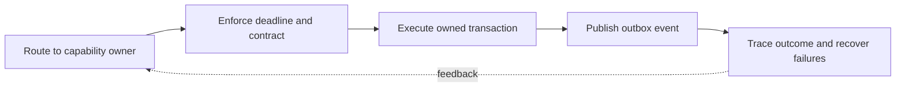

> **Level 3: Advanced** · Topic 30 of 40

[← Flask](./29-flask.md) · [↑ Level index](../README.md) · [Docker with Python →](./31-docker-with-python.md)

# Microservices

## Overview
- **What is it?** Microservices split a system into independently deployable services aligned to business capabilities and communicating through explicit network contracts.
- **Why is it important?** The approach trades local modularity for distributed-system costs: latency, partial failure, versioning, observability, data ownership, and operational overhead.
- **Where is it used?** It is appropriate when teams need independent delivery or scaling and can support mature platform operations.

## Learning Objectives
- Define service boundaries around ownership and cohesive capabilities.
- Design version-tolerant synchronous and asynchronous contracts.
- Apply deadlines, idempotency, tracing, bulkheads, and graceful degradation.

## Real World Applications
- Separating independently owned order, catalog, identity, or billing capabilities.
- Scaling compute-heavy services independently from transactional services.
- Isolating deployment risk where organizational ownership justifies the boundary.

## Core Concepts

### Capability and Data Boundaries
- **Definition:** A service owns its business rules and data; other services use contracts rather than reading its database tables directly.
- **Visual explanation:** `capability owner → service API/events → consumers; no shared-table coupling`
- **Practical example:**

```python
from dataclasses import dataclass

@dataclass(frozen=True)
class OrderPlaced:
    event_id: str
    order_id: str
    schema_version: int = 1
```

### Resilient Synchronous Calls
- **Definition:** Service clients need connection and read timeouts, bounded retries only for safe operations, and response validation.
- **Visual explanation:** `caller → deadline/bulkhead → service → validated response or fallback`
- **Practical example:**

```python
import requests

def fetch_catalog(item_id: str) -> dict[str, object]:
    response = requests.get(
        f"https://catalog.example/items/{item_id}",
        timeout=(1.0, 2.0),
        headers={"Accept": "application/json"},
    )
    response.raise_for_status()
    return response.json()
```

### Events and Observability
- **Definition:** Asynchronous integration decouples availability but requires idempotent consumers, schema evolution, correlation identifiers, and lag monitoring.
- **Visual explanation:** `transaction/outbox → broker → idempotent consumer → correlated telemetry`
- **Practical example:**

```python
handled: set[str] = set()

def consume(event: OrderPlaced) -> bool:
    if event.event_id in handled:
        return False
    handled.add(event.event_id)
    print("order", event.order_id)
    return True
```

## Infographic Summary

| Infographic Block | Topic-specific takeaway |
| --- | --- |
| 📌 Concept | Microservices split a system into independently deployable services aligned to business capabilities and communicating through explicit network contracts. |
| ⚡ Purpose | The approach trades local modularity for distributed-system costs: latency, partial failure, versioning, observability, data ownership, and operational overhead. |
| 🔥 Benefits | Builds the ability to define service boundaries around ownership and cohesive capabilities; it also helps practitioners design version-tolerant synchronous and asynchronous contracts. |
| 🎯 Use Cases | Separating independently owned order, catalog, identity, or billing capabilities. Scaling compute-heavy services independently from transactional services. |
| 🚀 Best Practices | Trace IDs connect calls, messages, logs, and metrics. |
| ❌ Common Mistakes | Ignoring the guardrail “Start with a modular monolith unless independent deployment solves a real constraint”. |

## Syntax Guide

### Basic Syntax

```python
from dataclasses import dataclass

@dataclass(frozen=True)
class ServiceResponse:
    request_id: str
    payload: dict[str, object]
```

### Standard Structure

```python
import uuid

headers = {
    "X-Request-ID": str(uuid.uuid4()),
    "Accept": "application/json",
}
```

### Code Pattern

```python
from collections.abc import Callable

def fallback(call: Callable[[], dict], default: dict) -> dict:
    try:
        return call()
    except (TimeoutError, ConnectionError):
        return default
```

## Examples

### Beginner Example

```python
def versioned_payload(order_id: str) -> dict[str, object]:
    return {"schema_version": 1, "order_id": order_id}
```

### Intermediate Example

```python
import requests

session = requests.Session()
session.headers["User-Agent"] = "orders-service/1.0"
response = session.get("https://example.com", timeout=(1, 3))
print(response.status_code)
session.close()
```

### Advanced Example

```python
from dataclasses import dataclass, field

@dataclass
class Outbox:
    pending: list[OrderPlaced] = field(default_factory=list)

    def append(self, event: OrderPlaced) -> None:
        self.pending.append(event)

    def publish(self, sender) -> None:
        remaining = []
        for event in self.pending:
            try:
                sender(event)
            except Exception:
                remaining.append(event)
        self.pending = remaining
```

## Workflow Diagram



---

[← Flask](./29-flask.md) · [↑ Level index](../README.md) · [Docker with Python →](./31-docker-with-python.md)
