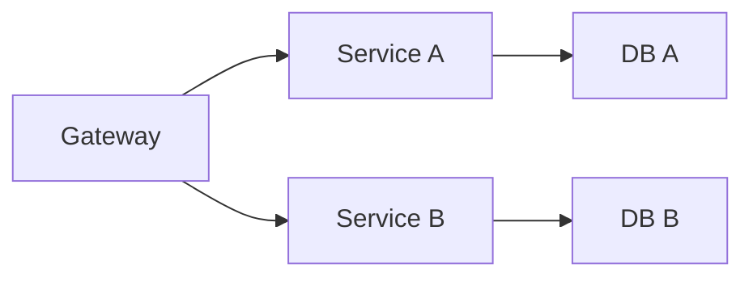

# Microservices

## Overview

- **What is it?** Microservices decompose applications into independently deployable services.
- **Why is it important?** Teams scale delivery and isolate failures per bounded context.
- **Where is it used?** Cloud-native SaaS, large product engineering orgs, platform teams.

## Learning Objectives

- **Skills gained:** Practical command of Microservices.
- **Concepts covered:**

- Define service boundaries.
- Communicate via HTTP/events.
- Implement observability and versioning.

- **Expected outcome:** You design service-oriented architectures with Python services.

## Real World Applications

- Streaming platforms
- Fintech
- E-commerce
- Enterprise SaaS

- **Business applications:** Automate workflows, reduce manual errors, accelerate delivery.
- **Career relevance:** Required knowledge for Python roles from junior developer to senior engineer.

## Core Concepts

### Bounded context

- **Definition:** Service owns its domain.
- **Visual explanation:** `Bounded context` → process → result
- **Practical example:**

```python
SERVICES = {'billing': ['invoices'], 'users': ['profiles']}
print(SERVICES['billing'])
```

### API gateway

- **Definition:** Single entry routing.
- **Visual explanation:** `API gateway` → process → result
- **Practical example:**

```python
GATEWAY = {'/users': 'user-svc'}
print(GATEWAY['/users'])
```

### Event bus

- **Definition:** Async integration.
- **Visual explanation:** `Event bus` → process → result
- **Practical example:**

```python
EVENTS = []
EVENTS.append({'type': 'OrderCreated'})
print(EVENTS[0]['type'])
```

## Infographic Summary

| Block | Summary |
| --- | --- |
| 📌 Concept | Microservices trade monolith simplicity for independent deployment. |
| ⚡ Purpose | Scale teams and components separately. |
| 🔥 Benefits | Isolation, tech diversity, targeted scaling. |
| 🎯 Use Cases | Checkout, notifications, search, recommendations. |
| 🚀 Best Practices | Contract tests; idempotent consumers; distributed tracing. |
| ❌ Common Mistakes | Distributed monolith, chatty sync calls, no versioning. |

## Syntax Guide

### Basic Syntax

```python
# service exposes /health and domain routes
```

### Standard Structure

```python
gateway -> services -> databases per service
```

### Code Pattern

```python
publish OrderCreated -> inventory service consumes
```

## Examples

### Beginner Example

```python
services = ['users', 'orders']
print(len(services))
```

### Intermediate Example

```python
def call_service(registry, name, path):
    base = registry[name]
    return f'{base}{path}'


registry = {'users': 'http://users:8000'}
print(call_service(registry, 'users', '/1'))
```

### Advanced Example

```python
from dataclasses import dataclass


@dataclass
class ServiceHealth:
    name: str
    ok: bool


def aggregate_health(checks: list[ServiceHealth]) -> bool:
    return all(h.ok for h in checks)


print(aggregate_health([ServiceHealth('a', True), ServiceHealth('b', True)]))
```

## Workflow Diagram



---
