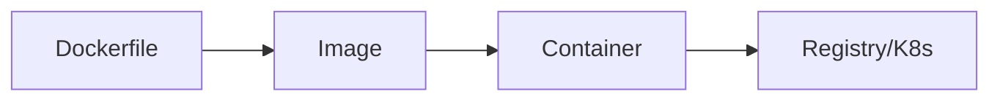

# Docker with Python

## Overview

- **What is it?** Docker packages Python apps with dependencies into portable containers.
- **Why is it important?** Containers reproduce dev/prod environments and simplify deployment.
- **Where is it used?** CI/CD, Kubernetes, cloud run, local dev stacks.

## Learning Objectives

- **Skills gained:** Practical command of Docker with Python.
- **Concepts covered:**

- Write Dockerfiles for Python apps.
- Use multi-stage builds.
- Run with docker compose for dependencies.

- **Expected outcome:** You containerize Python services production-ready.

## Real World Applications

- Cloud-native teams
- ML ops
- Consultancies
- Startups

- **Business applications:** Automate workflows, reduce manual errors, accelerate delivery.
- **Career relevance:** Required knowledge for Python roles from junior developer to senior engineer.

## Core Concepts

### Dockerfile

- **Definition:** Image build recipe.
- **Visual explanation:** `Dockerfile` → process → result
- **Practical example:**

```python
print('FROM python:3.12-slim'[:4])
```

### WORKDIR

- **Definition:** Set container working dir.
- **Visual explanation:** `WORKDIR` → process → result
- **Practical example:**

```python
WORKDIR = '/app'
print(WORKDIR)
```

### ENTRYPOINT

- **Definition:** Container start command.
- **Visual explanation:** `ENTRYPOINT` → process → result
- **Practical example:**

```python
CMD = ['python', 'app.py']
print(CMD[0])
```

## Infographic Summary

| Block | Summary |
| --- | --- |
| 📌 Concept | Images are immutable layers; containers are running instances. |
| ⚡ Purpose | Consistent runtime from laptop to cloud. |
| 🔥 Benefits | Isolation, reproducibility, fast rollouts. |
| 🎯 Use Cases | API containers, workers, notebooks batch jobs. |
| 🚀 Best Practices | Pin base image; non-root user; .dockerignore; healthcheck. |
| ❌ Common Mistakes | Huge images, secrets in layers, running as root, no pin requirements. |

## Syntax Guide

### Basic Syntax

```python
dockerfile = 'FROM python:3.12-slim\nCOPY requirements.txt .'
print(dockerfile.split()[0])
```

### Standard Structure

```python
base image -> deps -> copy app -> cmd
```

### Code Pattern

```python
stages = ['builder', 'runtime']
print(stages)
```

## Examples

### Beginner Example

```python
print('docker build -t myapp .')
```

### Intermediate Example

```python
dockerfile = '''FROM python:3.12-slim
WORKDIR /app
COPY requirements.txt .
RUN pip install --no-cache-dir -r requirements.txt
COPY . .
CMD ["python", "-m", "http.server", "8000"]
'''
print('WORKDIR' in dockerfile)
```

### Advanced Example

```python
stages = ['builder', 'runtime']
print(stages.index('runtime'))
```

## Workflow Diagram



---
