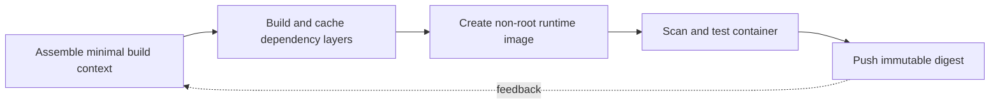

> **Level 3: Advanced** · Topic 31 of 40

[← Microservices](./30-microservices.md) · [↑ Level index](../README.md) · [Kubernetes Integration →](./32-kubernetes-integration.md)

# Docker with Python

## Overview
- **What is it?** Docker packages a Python application, interpreter, dependencies, and filesystem into an immutable image executed as an isolated container process.
- **Why is it important?** Secure, reproducible images use pinned lock data, multi-stage builds, a non-root runtime, small build contexts, health signals, and external configuration.
- **Where is it used?** Docker supports consistent development, CI, service deployment, batch jobs, and dependency isolation.

## Learning Objectives
- Write cache-efficient multi-stage Dockerfiles for Python.
- Run one foreground process as a non-root user with correct signal behavior.
- Scan, label, test, and promote immutable images by digest.

## Real World Applications
- Packaging web services and workers consistently across environments.
- Creating reproducible test environments in CI.
- Shipping immutable application artifacts to orchestrators.

## Core Concepts

### Images, Layers, and Build Context
- **Definition:** A Dockerfile creates content-addressed layers from a build context; stable dependency layers should precede frequently changing source layers.
- **Visual explanation:** `context + Dockerfile → cached layers → immutable image digest`
- **Practical example:**

```python
from pathlib import Path

required = {"Dockerfile", "pyproject.toml"}
context_files = {path.name for path in Path(".").iterdir()}
missing = required - context_files
if missing:
    print("missing build inputs", sorted(missing))
```

### Multi-stage Python Build
- **Definition:** A builder stage compiles wheels or installs dependencies, while the runtime stage copies only required artifacts and excludes compilers and caches.
- **Visual explanation:** `builder dependencies → wheel/venv artifact → minimal runtime stage`
- **Practical example:**

```python
dockerfile = '''
FROM python:3.12-slim AS builder
WORKDIR /build
COPY requirements.txt .
RUN pip wheel --no-cache-dir --wheel-dir /wheels -r requirements.txt

FROM python:3.12-slim AS runtime
RUN useradd --create-home app
COPY --from=builder /wheels /wheels
RUN pip install --no-cache-dir /wheels/* && rm -rf /wheels
USER app
WORKDIR /app
COPY --chown=app:app . .
CMD ["python", "-m", "service"]
'''
```

### Container Runtime Contract
- **Definition:** The application runs as PID 1, reads configuration from the environment, writes logs to standard streams, handles termination, and stores durable data externally.
- **Visual explanation:** `image + env/secrets → foreground process → stdout/health → graceful stop`
- **Practical example:**

```python
import signal

stopping = False

def request_stop(signum, frame) -> None:
    global stopping
    stopping = True

signal.signal(signal.SIGTERM, request_stop)
```

## Infographic Summary

| Infographic Block | Topic-specific takeaway |
| --- | --- |
| 📌 Concept | Docker packages a Python application, interpreter, dependencies, and filesystem into an immutable image executed as an isolated container process. |
| ⚡ Purpose | Secure, reproducible images use pinned lock data, multi-stage builds, a non-root runtime, small build contexts, health signals, and external configuration. |
| 🔥 Benefits | Builds the ability to write cache-efficient multi-stage Dockerfiles for Python; it also helps practitioners run one foreground process as a non-root user with correct signal behavior. |
| 🎯 Use Cases | Packaging web services and workers consistently across environments. Creating reproducible test environments in CI. |
| 🚀 Best Practices | `.dockerignore` removes secrets, VCS data, caches, and local environments. |
| ❌ Common Mistakes | Ignoring the guardrail “Never bake credentials or environment-specific config into image layers”. |

## Syntax Guide

### Basic Syntax

```python
from pathlib import Path

ignore = Path(".dockerignore")
patterns = {"__pycache__/", ".git/", ".venv/", ".env"}
```

### Standard Structure

```python
import os

port = int(os.environ.get("PORT", "8000"))
environment = os.environ.get("APP_ENV", "development")
```

### Code Pattern

```python
import json
import subprocess

def image_id(tag: str) -> str:
    result = subprocess.run(
        ["docker", "image", "inspect", tag, "--format", "{{json .Id}}"],
        check=True,
        capture_output=True,
        text=True,
    )
    return json.loads(result.stdout)
```

#### Deployment Artifact

```Dockerfile
FROM python:3.12-slim
WORKDIR /app
COPY requirements.txt .
RUN pip install --no-cache-dir -r requirements.txt
COPY . .
USER 1000:1000
CMD ["python", "-m", "service"]
```

## Examples

### Beginner Example

```python
dockerfile = '''
FROM python:3.12-slim
WORKDIR /app
COPY app.py .
CMD ["python", "app.py"]
'''
```

### Intermediate Example

```python
import subprocess

subprocess.run(
    ["docker", "build", "--tag", "learning-api:test", "."],
    check=True,
    timeout=600,
)
```

### Advanced Example

```python
import subprocess

subprocess.run(
    [
        "docker", "run", "--rm",
        "--read-only",
        "--cap-drop=ALL",
        "--user=1000:1000",
        "--env", "APP_ENV=test",
        "learning-api:test",
        "python", "-m", "pytest", "-q",
    ],
    check=True,
    timeout=300,
)
```

## Workflow Diagram



---

[← Microservices](./30-microservices.md) · [↑ Level index](../README.md) · [Kubernetes Integration →](./32-kubernetes-integration.md)
