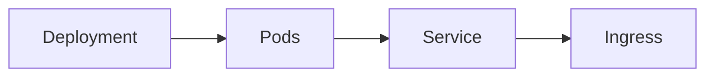

# Kubernetes Integration

## Overview

- **What is it?** Kubernetes orchestrates containers for scaling, networking, and self-healing deployments.
- **Why is it important?** Production services need automated rollout, health checks, and service discovery.
- **Where is it used?** Cloud platforms, platform engineering, microservice fleets.

## Learning Objectives

- **Skills gained:** Practical command of Kubernetes Integration.
- **Concepts covered:**

- Write Deployments and Services manifests.
- Configure probes and resource limits.
- Use ConfigMaps and Secrets.

- **Expected outcome:** You deploy Python apps to Kubernetes clusters.

## Real World Applications

- SaaS platforms
- FinTech cloud
- Media streaming
- ML serving

- **Business applications:** Automate workflows, reduce manual errors, accelerate delivery.
- **Career relevance:** Required knowledge for Python roles from junior developer to senior engineer.

## Core Concepts

### Pod

- **Definition:** Smallest deploy unit.
- **Visual explanation:** `Pod` → process → result
- **Practical example:**

```python
pod = {'name': 'api', 'containers': ['app']}
print(pod['containers'])
```

### Deployment

- **Definition:** Manages replica sets.
- **Visual explanation:** `Deployment` → process → result
- **Practical example:**

```python
spec = {'replicas': 3}
print(spec['replicas'])
```

### Service

- **Definition:** Stable network endpoint.
- **Visual explanation:** `Service` → process → result
- **Practical example:**

```python
svc = {'type': 'ClusterIP', 'port': 80}
print(svc['port'])
```

## Infographic Summary

| Block | Summary |
| --- | --- |
| 📌 Concept | Kubernetes desired state reconciles actual cluster state. |
| ⚡ Purpose | Run containers reliably at scale. |
| 🔥 Benefits | Self-healing, scaling, rolling updates. |
| 🎯 Use Cases | API fleets, workers, cron jobs. |
| 🚀 Best Practices | Liveness/readiness probes; limits/requests; 12-factor config. |
| ❌ Common Mistakes | No probes, OOM kills, latest tag in prod, huge ConfigMaps. |

## Syntax Guide

### Basic Syntax

```python
command = ['kubectl', 'apply', '-f', 'deployment.yaml']
print(command[0])
```

### Standard Structure

```python
Deployment -> Service -> Ingress -> HPA
```

### Code Pattern

```python
config = {'envFrom': 'configMap', 'mountSecrets': True}
print(config['envFrom'])
```

## Examples

### Beginner Example

```python
manifest = {'kind': 'Deployment', 'replicas': 1}
print(manifest['kind'])
```

### Intermediate Example

```python
deployment = {
    'spec': {
        'template': {
            'spec': {
                'containers': [{
                    'name': 'api',
                    'readinessProbe': {'httpGet': {'path': '/health', 'port': 8000}},
                }]
            }
        }
    }
}
probe = deployment['spec']['template']['spec']['containers'][0]['readinessProbe']
print(probe['httpGet']['path'])
```

### Advanced Example

```python
def rolling_update(current: int, desired: int, max_surge: int) -> int:
    return min(current + max_surge, desired)


print(rolling_update(2, 5, 1))
```

## Workflow Diagram



---
