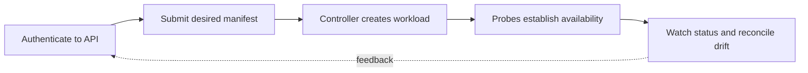

> **Level 3: Advanced** · Topic 32 of 40

[← Docker with Python](./31-docker-with-python.md) · [↑ Level index](../README.md) · [Cloud Development →](./33-cloud-development.md)

# Kubernetes Integration

## Overview
- **What is it?** Kubernetes reconciles declared workload state through APIs and controllers, while the Python client can inspect or modify resources using the same authenticated API.
- **Why is it important?** Reliable integrations use declarative manifests, namespaces, least-privilege service accounts, idempotent patching, watches, and conflict-aware retries.
- **Where is it used?** It is used for deploying Python services, writing operators, automating jobs, and integrating platform workflows.

## Learning Objectives
- Describe Pods, Deployments, Services, ConfigMaps, Secrets, and reconciliation.
- Use Kubernetes Python client configuration and typed APIs.
- Create safe manifests with probes, resources, security context, and rolling updates.

## Real World Applications
- Deploying replicated Python HTTP services and background workers.
- Creating Jobs or inspecting rollout state from automation.
- Building controllers that converge custom resources toward desired state.

## Core Concepts

### Declarative Reconciliation
- **Definition:** Clients submit desired objects to the API server and controllers repeatedly compare observed state with desired state until they converge.
- **Visual explanation:** `manifest → API server → controller reconcile loop → Pods/status`
- **Practical example:**

```python
from kubernetes import client, config

config.load_kube_config()
apps = client.AppsV1Api()
deployments = apps.list_namespaced_deployment(namespace="default")
print([item.metadata.name for item in deployments.items])
```

### Workload Runtime Contract
- **Definition:** A Deployment manages ReplicaSets and Pods; readiness gates traffic, liveness requests restarts, and resource requests inform scheduling.
- **Visual explanation:** `Deployment → ReplicaSet → Pods → readiness → Service endpoints`
- **Practical example:**

```python
deployment = client.V1Deployment(
    metadata=client.V1ObjectMeta(name="api"),
    spec=client.V1DeploymentSpec(
        replicas=2,
        selector=client.V1LabelSelector(match_labels={"app": "api"}),
        template=client.V1PodTemplateSpec(
            metadata=client.V1ObjectMeta(labels={"app": "api"}),
            spec=client.V1PodSpec(containers=[
                client.V1Container(name="api", image="example/api@sha256:digest")
            ]),
        ),
    ),
)
```

### API Safety and Watches
- **Definition:** Automation should scope namespace and RBAC, handle resource-version conflicts, watch from a known version, and make repeated actions converge.
- **Visual explanation:** `authenticate → read resourceVersion → patch desired fields → watch status`
- **Practical example:**

```python
from kubernetes import client, config, watch

config.load_kube_config()
core = client.CoreV1Api()
stream = watch.Watch().stream(
    core.list_namespaced_pod,
    namespace="default",
    timeout_seconds=30,
)
```

## Infographic Summary

| Infographic Block | Topic-specific takeaway |
| --- | --- |
| 📌 Concept | Kubernetes reconciles declared workload state through APIs and controllers, while the Python client can inspect or modify resources using the same authenticated API. |
| ⚡ Purpose | Reliable integrations use declarative manifests, namespaces, least-privilege service accounts, idempotent patching, watches, and conflict-aware retries. |
| 🔥 Benefits | Builds the ability to describe Pods, Deployments, Services, ConfigMaps, Secrets, and reconciliation; it also helps practitioners use Kubernetes Python client configuration and typed APIs. |
| 🎯 Use Cases | Deploying replicated Python HTTP services and background workers. Creating Jobs or inspecting rollout state from automation. |
| 🚀 Best Practices | RBAC grants verbs on named resource scopes. |
| ❌ Common Mistakes | Ignoring the guardrail “Avoid broad cluster-admin credentials and mutable image tags”. |

## Syntax Guide

### Basic Syntax

```python
from kubernetes import client, config

config.load_incluster_config()
core = client.CoreV1Api()
pods = core.list_namespaced_pod("default")
```

### Standard Structure

```python
job = client.V1Job(
    metadata=client.V1ObjectMeta(name="report"),
    spec=client.V1JobSpec(
        template=client.V1PodTemplateSpec(
            spec=client.V1PodSpec(
                restart_policy="Never",
                containers=[client.V1Container(name="report", image="example/report:1.0")],
            )
        )
    ),
)
```

### Code Pattern

```python
def scale(name: str, replicas: int, namespace: str = "default") -> None:
    api = client.AppsV1Api()
    body = {"spec": {"replicas": replicas}}
    api.patch_namespaced_deployment_scale(name, namespace, body)
```

#### Deployment Artifact

```yaml
apiVersion: apps/v1
kind: Deployment
metadata:
  name: learning-api
spec:
  selector:
    matchLabels:
      app: learning-api
  template:
    metadata:
      labels:
        app: learning-api
    spec:
      containers:
        - name: api
          image: example/learning-api:1.0
          readinessProbe:
            httpGet:
              path: /ready
              port: 8000
```

## Examples

### Beginner Example

```python
from kubernetes import client

metadata = client.V1ObjectMeta(
    name="lesson",
    labels={"app.kubernetes.io/name": "lesson"},
)
```

### Intermediate Example

```python
from kubernetes import client, config

config.load_kube_config()
batch = client.BatchV1Api()
created = batch.create_namespaced_job(namespace="default", body=job)
print(created.metadata.name)
```

### Advanced Example

```python
from kubernetes import client, config

config.load_kube_config()
apps = client.AppsV1Api()
status = apps.read_namespaced_deployment_status("api", "default").status
available = status.available_replicas or 0
desired = status.replicas or 0
if available < desired:
    raise RuntimeError(f"rollout incomplete: {available}/{desired}")
```

## Workflow Diagram



---

[← Docker with Python](./31-docker-with-python.md) · [↑ Level index](../README.md) · [Cloud Development →](./33-cloud-development.md)
