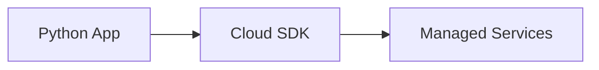

# Cloud Development

## Overview

- **What is it?** Cloud development builds apps leveraging managed services for compute, storage, and messaging.
- **Why is it important?** Cloud offloads ops for scaling, durability, and global reach.
- **Where is it used?** SaaS, data platforms, mobile backends, ML inference.

## Learning Objectives

- **Skills gained:** Practical command of Cloud Development.
- **Concepts covered:**

- Use object storage and managed databases.
- Apply IAM least privilege.
- Design for multi-region resilience.

- **Expected outcome:** You architect cloud-native Python solutions.

## Real World Applications

- Global SaaS
- Media
- Gaming backends
- Enterprise migration

- **Business applications:** Automate workflows, reduce manual errors, accelerate delivery.
- **Career relevance:** Required knowledge for Python roles from junior developer to senior engineer.

## Core Concepts

### Managed services

- **Definition:** Offload ops to provider.
- **Visual explanation:** `Managed services` → process → result
- **Practical example:**

```python
SERVICES = ['object-storage', 'queue', 'db']
print(len(SERVICES))
```

### IAM

- **Definition:** Identity and access control.
- **Visual explanation:** `IAM` → process → result
- **Practical example:**

```python
policy = {'allow': ['s3:GetObject']}
print(policy['allow'][0])
```

### Object storage

- **Definition:** Durable blob store.
- **Visual explanation:** `Object storage` → process → result
- **Practical example:**

```python
uri = 's3://bucket/key'
print(uri.startswith('s3://'))
```

## Infographic Summary

| Block | Summary |
| --- | --- |
| 📌 Concept | Cloud-native apps use managed APIs instead of self-hosted servers. |
| ⚡ Purpose | Scale without owning data centers. |
| 🔥 Benefits | Elasticity, global CDN, managed backups. |
| 🎯 Use Cases | Static assets, backups, event archives, ML datasets. |
| 🚀 Best Practices | Infrastructure as code; secrets manager; cost tags; observability. |
| ❌ Common Mistakes | Long-lived access keys in code, public buckets, no autoscaling. |

## Syntax Guide

### Basic Syntax

```python
client.upload_file('local.txt', 'bucket', 'key')
```

### Standard Structure

```python
app -> SDK -> managed API -> cloud resource
```

### Code Pattern

```python
upload artifact -> trigger lambda/worker
```

## Examples

### Beginner Example

```python
bucket = 'my-app-assets'
print(bucket.replace('-', '_'))
```

### Intermediate Example

```python
def presigned_url(bucket: str, key: str, ttl: int = 3600) -> str:
    return f'https://{bucket}.example.com/{key}?ttl={ttl}'


print('ttl=' in presigned_url('b', 'file.csv'))
```

### Advanced Example

```python
def multi_region_failover(primary_ok: bool, secondary_ok: bool) -> str:
    if primary_ok:
        return 'primary'
    if secondary_ok:
        return 'secondary'
    raise RuntimeError('all regions down')


print(multi_region_failover(True, False))
```

## Workflow Diagram



---
