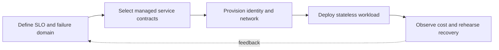

> **Level 3: Advanced** · Topic 33 of 40

[← Kubernetes Integration](./32-kubernetes-integration.md) · [↑ Level index](../README.md) · [AWS with Python →](./34-aws-with-python.md)

# Cloud Development

## Overview
- **What is it?** Cloud development builds applications from managed compute, storage, messaging, identity, and observability services exposed through APIs.
- **Why is it important?** Portable application code still needs provider-aware decisions about consistency, quotas, networking, identity, cost, and failure domains.
- **Where is it used?** It supports elastic web services, event-driven processing, data platforms, globally distributed delivery, and managed operations.

## Learning Objectives
- Design stateless compute with external durable state and asynchronous work.
- Use workload identity, least privilege, retries, and idempotency around cloud APIs.
- Model regions, availability zones, quotas, cost, and observability.

## Real World Applications
- Autoscaled APIs backed by managed databases and object storage.
- Event-triggered functions and durable queue-based workers.
- Multi-zone systems with tested backup and recovery objectives.

## Core Concepts

### Managed Service Contracts
- **Definition:** A managed service removes some operations but exposes API semantics, quotas, consistency, pricing, and regional availability that architecture must honor.
- **Visual explanation:** `application → SDK/API contract → managed control/data plane`
- **Practical example:**

```python
from dataclasses import dataclass

@dataclass(frozen=True)
class ServiceLimit:
    requests_per_second: int
    maximum_payload_bytes: int
```

### Identity and Configuration
- **Definition:** Applications should obtain short-lived workload credentials from the runtime and keep nonsecret configuration separate from image artifacts.
- **Visual explanation:** `workload identity → temporary token → scoped API request`
- **Practical example:**

```python
import os

region = os.environ["CLOUD_REGION"]
bucket = os.environ["OBJECT_BUCKET"]
if not region or not bucket:
    raise RuntimeError("cloud configuration is incomplete")
```

### Failure Domains and Recovery
- **Definition:** Regions and zones define correlated failure boundaries; recovery objectives determine replication, backup, restore, and failover design.
- **Visual explanation:** `service SLO + RPO/RTO → redundancy/backup plan → recovery drill`
- **Practical example:**

```python
from dataclasses import dataclass
from datetime import timedelta

@dataclass(frozen=True)
class RecoveryObjective:
    maximum_data_loss: timedelta
    maximum_downtime: timedelta
```

## Infographic Summary

| Infographic Block | Topic-specific takeaway |
| --- | --- |
| 📌 Concept | Cloud development builds applications from managed compute, storage, messaging, identity, and observability services exposed through APIs. |
| ⚡ Purpose | Portable application code still needs provider-aware decisions about consistency, quotas, networking, identity, cost, and failure domains. |
| 🔥 Benefits | Builds the ability to design stateless compute with external durable state and asynchronous work; it also helps practitioners use workload identity, least privilege, retries, and idempotency around cloud APIs. |
| 🎯 Use Cases | Autoscaled APIs backed by managed databases and object storage. Event-triggered functions and durable queue-based workers. |
| 🚀 Best Practices | RPO bounds data loss; RTO bounds restoration time. |
| ❌ Common Mistakes | Ignoring the guardrail “Tag resources and monitor unit cost, saturation, errors, and latency”. |

## Syntax Guide

### Basic Syntax

```python
from dataclasses import dataclass

@dataclass(frozen=True)
class CloudConfig:
    region: str
    object_bucket: str
    queue_name: str
```

### Standard Structure

```python
import random

def retry_delay(attempt: int, cap: float = 8.0) -> float:
    return random.uniform(0, min(cap, 0.2 * 2 ** attempt))
```

### Code Pattern

```python
from typing import Protocol

class ObjectStore(Protocol):
    def put(self, key: str, body: bytes) -> None: ...
    def get(self, key: str) -> bytes: ...
```

## Examples

### Beginner Example

```python
import os

environment = os.getenv("APP_ENV", "development")
print({"environment": environment})
```

### Intermediate Example

```python
from hashlib import sha256

def object_key(body: bytes) -> str:
    digest = sha256(body).hexdigest()
    return f"objects/{digest[:2]}/{digest}"
```

### Advanced Example

```python
from dataclasses import dataclass

@dataclass
class MemoryObjectStore:
    objects: dict[str, bytes]

    def put(self, key: str, body: bytes) -> None:
        self.objects.setdefault(key, body)

    def get(self, key: str) -> bytes:
        return self.objects[key]

store: ObjectStore = MemoryObjectStore({})
key = object_key(b"immutable payload")
store.put(key, b"immutable payload")
assert store.get(key) == b"immutable payload"
```

## Workflow Diagram



---

[← Kubernetes Integration](./32-kubernetes-integration.md) · [↑ Level index](../README.md) · [AWS with Python →](./34-aws-with-python.md)
