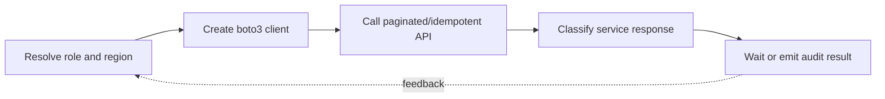

> **Level 3: Advanced** · Topic 34 of 40

[← Cloud Development](./33-cloud-development.md) · [↑ Level index](../README.md) · [Azure with Python →](./35-azure-with-python.md)

# AWS with Python

## Overview
- **What is it?** boto3 is the AWS SDK for Python, exposing service clients and higher-level resources configured through the standard credential and region provider chains.
- **Why is it important?** Reliable AWS code uses IAM least privilege, pagination, waiters, retries, idempotency, and service-specific error inspection.
- **Where is it used?** It is used to automate S3, DynamoDB, SQS, Lambda, infrastructure operations, and observability workflows.

## Learning Objectives
- Create boto3 sessions and clients without embedding credentials.
- Use paginators, waiters, conditional writes, and SDK error codes.
- Design idempotent operations with bounded concurrency and auditability.

## Real World Applications
- Managing versioned objects and lifecycle-aware data in Amazon S3.
- Publishing queue messages and operating event-driven workers.
- Automating inventory, tagging, backup, and deployment checks.

## Core Concepts

### Sessions and Credential Resolution
- **Definition:** A boto3 Session resolves region and short-lived credentials through explicit configuration, profiles, environment, containers, or instance roles.
- **Visual explanation:** `provider chain → signed request → regional AWS endpoint`
- **Practical example:**

```python
import boto3

session = boto3.Session(region_name="us-east-1")
s3 = session.client("s3")
print(session.region_name)
```

### Pagination and Waiters
- **Definition:** List APIs return bounded pages and continuation tokens; paginators iterate all pages, while waiters poll modeled resource states.
- **Visual explanation:** `API page + token → paginator → complete stream; create → waiter → ready`
- **Practical example:**

```python
import boto3

s3 = boto3.client("s3")
paginator = s3.get_paginator("list_objects_v2")
for page in paginator.paginate(Bucket="example-bucket", Prefix="reports/"):
    for item in page.get("Contents", []):
        print(item["Key"])
```

### Errors and Conditional Effects
- **Definition:** botocore exposes structured service error codes; callers should distinguish expected conflicts and throttling from authorization or validation failures.
- **Visual explanation:** `ClientError → service code → recover, retry, or fail permanently`
- **Practical example:**

```python
import boto3
from botocore.exceptions import ClientError

table = boto3.resource("dynamodb").Table("jobs")
try:
    table.put_item(
        Item={"job_id": "J-7", "state": "new"},
        ConditionExpression="attribute_not_exists(job_id)",
    )
except ClientError as error:
    if error.response["Error"]["Code"] != "ConditionalCheckFailedException":
        raise
```

## Infographic Summary

| Infographic Block | Topic-specific takeaway |
| --- | --- |
| 📌 Concept | boto3 is the AWS SDK for Python, exposing service clients and higher-level resources configured through the standard credential and region provider chains. |
| ⚡ Purpose | Reliable AWS code uses IAM least privilege, pagination, waiters, retries, idempotency, and service-specific error inspection. |
| 🔥 Benefits | Builds the ability to create boto3 sessions and clients without embedding credentials; it also helps practitioners use paginators, waiters, conditional writes, and SDK error codes. |
| 🎯 Use Cases | Managing versioned objects and lifecycle-aware data in Amazon S3. Publishing queue messages and operating event-driven workers. |
| 🚀 Best Practices | DynamoDB condition expressions make writes concurrency-safe. |
| ❌ Common Mistakes | Ignoring the guardrail “Never hard-code access keys or assume one API response contains every item”. |

## Syntax Guide

### Basic Syntax

```python
import boto3

s3 = boto3.client("s3", region_name="us-east-1")
response = s3.get_object(Bucket="example-bucket", Key="data/report.json")
body = response["Body"].read()
```

### Standard Structure

```python
sqs = boto3.client("sqs")
result = sqs.send_message(
    QueueUrl="https://sqs.us-east-1.amazonaws.com/123/jobs",
    MessageBody='{"job_id":"J-7"}',
)
```

### Code Pattern

```python
from botocore.config import Config

config = Config(
    retries={"mode": "adaptive", "max_attempts": 5},
    connect_timeout=2,
    read_timeout=10,
)
client = boto3.client("s3", config=config)
```

## Examples

### Beginner Example

```python
import boto3

sts = boto3.client("sts")
identity = sts.get_caller_identity()
print(identity["Arn"])
```

### Intermediate Example

```python
import json
import boto3

s3 = boto3.client("s3")
payload = json.dumps({"status": "ready"}).encode()
s3.put_object(
    Bucket="example-bucket",
    Key="status/current.json",
    Body=payload,
    ContentType="application/json",
)
```

### Advanced Example

```python
import json
import boto3

def process(body: str) -> None:
    job = json.loads(body)
    print(f"processing job {job['id']}")

sqs = boto3.client("sqs")
response = sqs.receive_message(
    QueueUrl="https://sqs.us-east-1.amazonaws.com/123/jobs",
    MaxNumberOfMessages=10,
    WaitTimeSeconds=20,
    VisibilityTimeout=60,
)
for message in response.get("Messages", []):
    process(message["Body"])
    sqs.delete_message(
        QueueUrl="https://sqs.us-east-1.amazonaws.com/123/jobs",
        ReceiptHandle=message["ReceiptHandle"],
    )
```

## Workflow Diagram



---

[← Cloud Development](./33-cloud-development.md) · [↑ Level index](../README.md) · [Azure with Python →](./35-azure-with-python.md)
