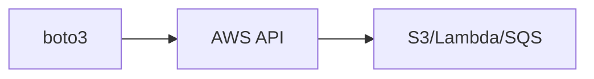

# AWS with Python

## Overview

- **What is it?** AWS with Python uses boto3 to interact with S3, Lambda, DynamoDB, SQS, and more.
- **Why is it important?** AWS dominates enterprise cloud; automation requires SDK fluency.
- **Where is it used?** Serverless APIs, data lakes, batch ETL, infra automation.

## Learning Objectives

- **Skills gained:** Practical command of AWS with Python.
- **Concepts covered:**

- Configure boto3 clients and resources.
- Upload/download S3 objects.
- Invoke Lambda and publish to SQS.

- **Expected outcome:** You automate AWS resources from Python with boto3 patterns.

## Real World Applications

- Enterprise cloud
- Startups on AWS
- Media storage
- Fintech

- **Business applications:** Automate workflows, reduce manual errors, accelerate delivery.
- **Career relevance:** Required knowledge for Python roles from junior developer to senior engineer.

## Core Concepts

### boto3 client

- **Definition:** Low-level service client.
- **Visual explanation:** `boto3 client` → process → result
- **Practical example:**

```python
print('boto3'[:4])
```

### S3

- **Definition:** Object storage.
- **Visual explanation:** `S3` → process → result
- **Practical example:**

```python
key = 's3://bucket/path'
print(key.split('/')[2])
```

### Lambda handler

- **Definition:** Function entrypoint.
- **Visual explanation:** `Lambda handler` → process → result
- **Practical example:**

```python
def handler(event, context):
    return {'statusCode': 200, 'body': 'ok'}
print(handler({}, None)['statusCode'])
```

## Infographic Summary

| Block | Summary |
| --- | --- |
| 📌 Concept | boto3 wraps AWS HTTP APIs with Python methods. |
| ⚡ Purpose | Programmatic cloud infrastructure and data access. |
| 🔥 Benefits | Full AWS surface, IAM integration, mature docs. |
| 🎯 Use Cases | Backup scripts, ETL triggers, infra provisioning. |
| 🚀 Best Practices | Use IAM roles not keys; paginate list calls; retries with backoff. |
| ❌ Common Mistakes | Hard-coded credentials, overly broad IAM, no region set. |

## Syntax Guide

### Basic Syntax

```python
import boto3
s3 = boto3.client('s3')
```

### Standard Structure

```python
session -> client -> API call -> handle pagination
```

### Code Pattern

```python
s3.upload_file(local, bucket, key)
```

## Examples

### Beginner Example

```python
def lambda_handler(event, context):
    return {'statusCode': 200}
print(lambda_handler({}, None))
```

### Intermediate Example

```python
def s3_uri(bucket: str, key: str) -> str:
    return f's3://{bucket}/{key}'


print(s3_uri('logs', '2026/06/app.log'))
```

### Advanced Example

```python
def paginate(items, page_size=2):
    for i in range(0, len(items), page_size):
        yield items[i:i + page_size]


print(list(paginate(list(range(5)), 2)))
```

## Workflow Diagram



---
