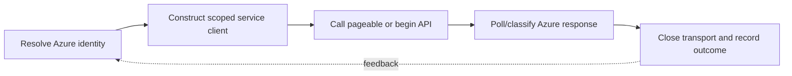

> **Level 3: Advanced** · Topic 35 of 40

[← AWS with Python](./34-aws-with-python.md) · [↑ Level index](../README.md) · [GCP with Python →](./36-gcp-with-python.md)

# Azure with Python

## Overview
- **What is it?** Azure SDK for Python packages expose service clients that authenticate through Azure Identity and call Azure data-plane or management-plane APIs.
- **Why is it important?** Applications should use `DefaultAzureCredential`, explicit resource scopes, async clients when appropriate, paging, long-running-operation pollers, and structured Azure errors.
- **Where is it used?** It is used with Blob Storage, Service Bus, Key Vault, Cosmos DB, Azure ML, and Resource Manager.

## Learning Objectives
- Authenticate Azure SDK clients with workload or developer identity.
- Use Blob Storage paging and upload APIs safely.
- Handle async clients, pollers, retries, and `azure.core` exceptions.

## Real World Applications
- Uploading application artifacts and datasets to Azure Blob Storage.
- Publishing messages and retrieving secrets through managed identity.
- Automating resource inventory and long-running management operations.

## Core Concepts

### Azure Identity
- **Definition:** `DefaultAzureCredential` tries a documented chain suitable for local development and hosted workload identity without putting secrets in source.
- **Visual explanation:** `developer/workload identity → OAuth token → Azure service client`
- **Practical example:**

```python
from azure.identity import DefaultAzureCredential
from azure.storage.blob import BlobServiceClient

credential = DefaultAzureCredential()
blobs = BlobServiceClient(
    account_url="https://example.blob.core.windows.net",
    credential=credential,
)
```

### Data-plane Clients and Paging
- **Definition:** Service clients create resource-scoped clients, and list operations expose pageable iterators that fetch continuation pages lazily.
- **Visual explanation:** `service client → container client → pageable API → resources`
- **Practical example:**

```python
container = blobs.get_container_client("reports")
for blob in container.list_blobs(name_starts_with="daily/"):
    print(blob.name, blob.size)
```

### Pollers and Azure Errors
- **Definition:** Management and copy operations may return pollers; SDK exceptions carry HTTP status and service details for retry or operator decisions.
- **Visual explanation:** `begin operation → poll status → result or `HttpResponseError``
- **Practical example:**

```python
from azure.core.exceptions import HttpResponseError, ResourceNotFoundError

blob = container.get_blob_client("daily/report.json")
try:
    properties = blob.get_blob_properties()
except ResourceNotFoundError:
    properties = None
except HttpResponseError:
    raise
```

## Infographic Summary

| Infographic Block | Topic-specific takeaway |
| --- | --- |
| 📌 Concept | Azure SDK for Python packages expose service clients that authenticate through Azure Identity and call Azure data-plane or management-plane APIs. |
| ⚡ Purpose | Applications should use `DefaultAzureCredential`, explicit resource scopes, async clients when appropriate, paging, long-running-operation pollers, and structured Azure errors. |
| 🔥 Benefits | Builds the ability to authenticate Azure SDK clients with workload or developer identity; it also helps practitioners use Blob Storage paging and upload APIs safely. |
| 🎯 Use Cases | Uploading application artifacts and datasets to Azure Blob Storage. Publishing messages and retrieving secrets through managed identity. |
| 🚀 Best Practices | `azure.core.exceptions` distinguishes transport and service failures. |
| ❌ Common Mistakes | Ignoring the guardrail “Close clients or use context managers to release transports”. |

## Syntax Guide

### Basic Syntax

```python
from azure.identity import DefaultAzureCredential

credential = DefaultAzureCredential()
token = credential.get_token("https://storage.azure.com/.default")
```

### Standard Structure

```python
blob = blobs.get_blob_client(container="reports", blob="daily/result.json")
blob.upload_blob(b'{"status":"ready"}', overwrite=True)
```

### Code Pattern

```python
from azure.identity.aio import DefaultAzureCredential
from azure.storage.blob.aio import BlobServiceClient

async def list_names(account_url: str) -> list[str]:
    async with DefaultAzureCredential() as credential:
        async with BlobServiceClient(account_url, credential=credential) as service:
            container = service.get_container_client("reports")
            return [item.name async for item in container.list_blobs()]
```

## Examples

### Beginner Example

```python
from azure.identity import DefaultAzureCredential
from azure.keyvault.secrets import SecretClient

client = SecretClient(
    vault_url="https://example.vault.azure.net",
    credential=DefaultAzureCredential(),
)
secret = client.get_secret("database-url")
```

### Intermediate Example

```python
from azure.core.exceptions import ResourceExistsError

container = blobs.get_container_client("reports")
try:
    container.create_container()
except ResourceExistsError:
    pass
```

### Advanced Example

```python
from azure.servicebus import ServiceBusClient, ServiceBusMessage
from azure.identity import DefaultAzureCredential

namespace = "example.servicebus.windows.net"
with DefaultAzureCredential() as credential:
    with ServiceBusClient(
        fully_qualified_namespace=namespace,
        credential=credential,
    ) as service_bus:
        with service_bus.get_queue_sender("jobs") as sender:
            sender.send_messages(
                ServiceBusMessage('{"job_id":"J-7"}', message_id="J-7")
            )
```

## Workflow Diagram



---

[← AWS with Python](./34-aws-with-python.md) · [↑ Level index](../README.md) · [GCP with Python →](./36-gcp-with-python.md)
