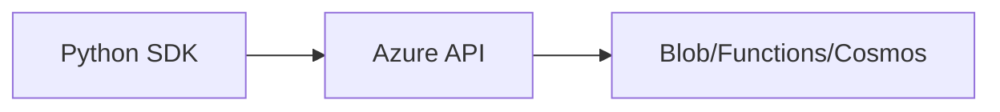

# Azure with Python

## Overview

- **What is it?** Azure with Python uses azure-sdk-for-python to manage storage, functions, and cloud resources.
- **Why is it important?** Enterprises on Microsoft cloud need Python automation and app integration.
- **Where is it used?** Azure Functions, Blob Storage, Cosmos DB, enterprise integrations.

## Learning Objectives

- **Skills gained:** Practical command of Azure with Python.
- **Concepts covered:**

- Authenticate with DefaultAzureCredential.
- Use Blob SDK for uploads.
- Deploy Python functions to Azure.

- **Expected outcome:** You integrate Python workloads with Azure services.

## Real World Applications

- Enterprise IT
- Healthcare on Azure
- Government
- Hybrid cloud

- **Business applications:** Automate workflows, reduce manual errors, accelerate delivery.
- **Career relevance:** Required knowledge for Python roles from junior developer to senior engineer.

## Core Concepts

### Blob storage

- **Definition:** Object storage on Azure.
- **Visual explanation:** `Blob storage` → process → result
- **Practical example:**

```python
uri = 'https://account.blob.core.windows.net/container/blob'
print('blob' in uri)
```

### DefaultAzureCredential

- **Definition:** Unified auth chain.
- **Visual explanation:** `DefaultAzureCredential` → process → result
- **Practical example:**

```python
print('credential chain pattern')
```

### Function app

- **Definition:** Serverless Python host.
- **Visual explanation:** `Function app` → process → result
- **Practical example:**

```python
def main(req):
    return {'status': 200}
print(main({})['status'])
```

## Infographic Summary

| Block | Summary |
| --- | --- |
| 📌 Concept | Azure SDK mirrors AWS patterns with Azure-specific services. |
| ⚡ Purpose | Build and automate on Microsoft cloud. |
| 🔥 Benefits | Active Directory integration, hybrid tooling. |
| 🎯 Use Cases | Blob ETL, enterprise SSO apps, IoT hub ingestion. |
| 🚀 Best Practices | Managed identity; key vault secrets; monitor with App Insights. |
| ❌ Common Mistakes | Connection strings in git, wrong subscription context. |

## Syntax Guide

### Basic Syntax

```python
from azure.storage.blob import BlobServiceClient
```

### Standard Structure

```python
credential -> client -> operation -> retry policy
```

### Code Pattern

```python
BlobServiceClient.from_connection_string(conn)
```

## Examples

### Beginner Example

```python
account = 'myaccount'
print(f'https://{account}.blob.core.windows.net')
```

### Intermediate Example

```python
def blob_path(container: str, name: str) -> str:
    return f'{container}/{name}'


print(blob_path('logs', 'app.log'))
```

### Advanced Example

```python
class RetryPolicy:
    def __init__(self, retries=3):
        self.retries = retries

    def run(self, func):
        last = None
        for _ in range(self.retries):
            try:
                return func()
            except Exception as exc:
                last = exc
        raise last


print(RetryPolicy().run(lambda: 'ok'))
```

## Workflow Diagram



---
