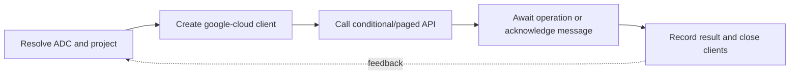

> **Level 3: Advanced** · Topic 36 of 40

[← Azure with Python](./35-azure-with-python.md) · [↑ Level index](../README.md) · [DevOps Automation →](./37-devops-automation.md)

# GCP with Python

## Overview
- **What is it?** Google Cloud Python libraries provide idiomatic clients for services such as Cloud Storage, Pub/Sub, BigQuery, and Secret Manager using Application Default Credentials.
- **Why is it important?** Reliable code uses service accounts or workload identity, project/location configuration, iterators, preconditions, deadlines, and `google.api_core` retry semantics.
- **Where is it used?** It is used for object storage, analytics, messaging, AI platforms, and cloud operations.

## Learning Objectives
- Authenticate google-cloud clients with Application Default Credentials.
- Use Cloud Storage generations and Pub/Sub acknowledgements safely.
- Configure timeouts, retries, paging, and structured Google API errors.

## Real World Applications
- Uploading versioned data and artifacts to Cloud Storage.
- Publishing and consuming messages through Pub/Sub.
- Submitting BigQuery jobs and automating cloud resource workflows.

## Core Concepts

### Application Default Credentials
- **Definition:** ADC searches the runtime's supported identity sources and scopes tokens for a client, avoiding embedded service-account keys.
- **Visual explanation:** `developer/workload identity → ADC token → google-cloud client`
- **Practical example:**

```python
import google.auth
from google.cloud import storage

credentials, project = google.auth.default()
client = storage.Client(project=project, credentials=credentials)
```

### Object Generations and Preconditions
- **Definition:** Cloud Storage assigns a generation to each object version; generation-match preconditions prevent lost updates and make retries safe.
- **Visual explanation:** `read generation → conditional write → new immutable generation`
- **Practical example:**

```python
from google.cloud import storage

client = storage.Client()
blob = client.bucket("example-bucket").blob("reports/current.json")
blob.upload_from_string(
    '{"status":"ready"}',
    content_type="application/json",
    if_generation_match=0,
    timeout=30,
)
```

### Pub/Sub Delivery
- **Definition:** Pub/Sub subscribers receive messages at least once and acknowledge only after an idempotent handler durably completes.
- **Visual explanation:** `publisher → topic/subscription → handler → durable effect → ack`
- **Practical example:**

```python
from google.cloud import pubsub_v1

subscriber = pubsub_v1.SubscriberClient()

def callback(message: pubsub_v1.subscriber.message.Message) -> None:
    handle(message.message_id, message.data)
    message.ack()
```

## Infographic Summary

| Infographic Block | Topic-specific takeaway |
| --- | --- |
| 📌 Concept | Google Cloud Python libraries provide idiomatic clients for services such as Cloud Storage, Pub/Sub, BigQuery, and Secret Manager using Application Default Credentials. |
| ⚡ Purpose | Reliable code uses service accounts or workload identity, project/location configuration, iterators, preconditions, deadlines, and `google.api_core` retry semantics. |
| 🔥 Benefits | Builds the ability to authenticate google-cloud clients with Application Default Credentials; it also helps practitioners use Cloud Storage generations and Pub/Sub acknowledgements safely. |
| 🎯 Use Cases | Uploading versioned data and artifacts to Cloud Storage. Publishing and consuming messages through Pub/Sub. |
| 🚀 Best Practices | `google.api_core.retry.Retry` targets selected transient exceptions. |
| ❌ Common Mistakes | Ignoring the guardrail “Avoid downloadable service-account keys for hosted workloads”. |

## Syntax Guide

### Basic Syntax

```python
from google.cloud import storage

client = storage.Client()
bucket = client.bucket("example-bucket")
names = [blob.name for blob in client.list_blobs(bucket, prefix="daily/")]
```

### Standard Structure

```python
from google.cloud import pubsub_v1

publisher = pubsub_v1.PublisherClient()
topic = publisher.topic_path("example-project", "jobs")
future = publisher.publish(topic, b'{"job_id":"J-7"}', schema="v1")
message_id = future.result(timeout=10)
```

### Code Pattern

```python
from google.api_core import retry
from google.api_core.exceptions import ServiceUnavailable

transient_retry = retry.Retry(
    predicate=retry.if_exception_type(ServiceUnavailable),
    deadline=30,
)
```

## Examples

### Beginner Example

```python
from google.cloud import storage

client = storage.Client()
for bucket in client.list_buckets(page_size=20):
    print(bucket.name)
```

### Intermediate Example

```python
from google.cloud import bigquery

client = bigquery.Client()
job = client.query(
    "SELECT word, word_count FROM `bigquery-public-data.samples.shakespeare` "
    "ORDER BY word_count DESC LIMIT 5"
)
for row in job.result(timeout=60):
    print(row.word, row.word_count)
```

### Advanced Example

```python
from google.cloud import pubsub_v1

subscriber = pubsub_v1.SubscriberClient()
path = subscriber.subscription_path("example-project", "jobs-subscription")
streaming_pull = subscriber.subscribe(path, callback=callback)
try:
    streaming_pull.result(timeout=60)
except TimeoutError:
    streaming_pull.cancel()
    streaming_pull.result()
```

## Workflow Diagram



---

[← Azure with Python](./35-azure-with-python.md) · [↑ Level index](../README.md) · [DevOps Automation →](./37-devops-automation.md)
