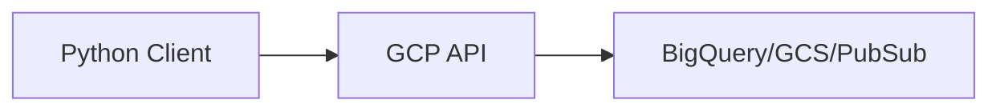

# GCP with Python

## Overview

- **What is it?** GCP with Python uses google-cloud libraries for Storage, BigQuery, Pub/Sub, and Cloud Run.
- **Why is it important?** Google Cloud excels at data analytics and Kubernetes (GKE).
- **Where is it used?** Analytics pipelines, ML on GCP, Pub/Sub event systems, Cloud Run APIs.

## Learning Objectives

- **Skills gained:** Practical command of GCP with Python.
- **Concepts covered:**

- Authenticate with service accounts.
- Query BigQuery from Python.
- Publish/consume Pub/Sub messages.

- **Expected outcome:** You build data and event-driven apps on GCP.

## Real World Applications

- Ad tech
- Analytics
- ML platforms
- Mobile backends

- **Business applications:** Automate workflows, reduce manual errors, accelerate delivery.
- **Career relevance:** Required knowledge for Python roles from junior developer to senior engineer.

## Core Concepts

### BigQuery

- **Definition:** Warehouse SQL engine.
- **Visual explanation:** `BigQuery` → process → result
- **Practical example:**

```python
sql = 'SELECT 1 AS one'
print(sql.split()[0])
```

### GCS

- **Definition:** Google Cloud Storage.
- **Visual explanation:** `GCS` → process → result
- **Practical example:**

```python
uri = 'gs://bucket/object'
print(uri.startswith('gs://'))
```

### Pub/Sub

- **Definition:** Messaging service.
- **Visual explanation:** `Pub/Sub` → process → result
- **Practical example:**

```python
topic = 'projects/p/topics/t'
print(topic.split('/')[-1])
```

## Infographic Summary

| Block | Summary |
| --- | --- |
| 📌 Concept | GCP client libraries wrap REST/gRPC service APIs. |
| ⚡ Purpose | Analytics and event-driven cloud apps. |
| 🔥 Benefits | BigQuery integration, strong data tooling, GKE. |
| 🎯 Use Cases | Log sinks to BQ, model batch scoring, async workers. |
| 🚀 Best Practices | Workload identity; IAM roles; partition BigQuery tables. |
| ❌ Common Mistakes | Public buckets, streaming inserts without dedupe keys. |

## Syntax Guide

### Basic Syntax

```python
from google.cloud import storage
client = storage.Client()
```

### Standard Structure

```python
client -> API -> handle pages -> monitor quotas
```

### Code Pattern

```python
bq_client.query(sql).result()
```

## Examples

### Beginner Example

```python
print('gs://my-bucket/data.csv'.split('/')[2])
```

### Intermediate Example

```python
def pubsub_message(data: bytes, attrs: dict | None = None) -> dict:
    return {'data': data.decode(), 'attributes': attrs or {}}


print(pubsub_message(b'hello', {'type': 'event'}))
```

### Advanced Example

```python
def bigquery_job_state(done: bool, errors: list | None = None) -> str:
    if errors:
        return 'FAILED'
    return 'DONE' if done else 'RUNNING'


print(bigquery_job_state(True))
```

## Workflow Diagram



---
