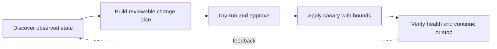

> **Level 3: Advanced** · Topic 37 of 40

[← GCP with Python](./36-gcp-with-python.md) · [↑ Level index](../README.md) · [CI/CD Pipelines →](./38-ci-cd-pipelines.md)

# DevOps Automation

## Overview
- **What is it?** DevOps automation turns build, infrastructure, release, and operational procedures into versioned, repeatable, observable workflows.
- **Why is it important?** Safe automation is idempotent, least-privileged, reviewable, bounded by timeouts, and able to report partial failure without hiding it.
- **Where is it used?** It supports environment checks, release orchestration, configuration generation, fleet inventory, and incident runbooks.

## Learning Objectives
- Implement safe filesystem and subprocess operations with explicit plans.
- Make automation idempotent, resumable, and structured for CI or operators.
- Add dry-run, audit events, concurrency bounds, and rollback criteria.

## Real World Applications
- Validating repositories and packaging release artifacts.
- Generating configuration from typed inputs without embedding secrets.
- Executing approved maintenance across a bounded host or service inventory.

## Core Concepts

### Desired State and Idempotency
- **Definition:** Automation should compare observed state with desired state and change only the difference, so repeating a successful run converges.
- **Visual explanation:** `desired state + observed state → plan delta → apply → verify`
- **Practical example:**

```python
from pathlib import Path

def ensure_text(path: Path, desired: str, dry_run: bool = False) -> bool:
    current = path.read_text() if path.exists() else None
    if current == desired:
        return False
    if not dry_run:
        path.write_text(desired)
    return True
```

### Bounded Command Execution
- **Definition:** Commands use explicit argument vectors, known working directories, scrubbed environments, checked status, captured evidence, and deadlines.
- **Visual explanation:** `validated argv/env → subprocess → status/stdout/stderr → structured result`
- **Practical example:**

```python
import subprocess

def run_check(arguments: list[str]) -> str:
    result = subprocess.run(
        arguments,
        check=True,
        capture_output=True,
        text=True,
        timeout=120,
    )
    return result.stdout
```

### Plans, Rollouts, and Verification
- **Definition:** High-impact automation separates planning from application, limits blast radius in batches, verifies health, and stops before expanding a failed rollout.
- **Visual explanation:** `inventory → plan → canary batch → health gate → progressive rollout`
- **Practical example:**

```python
from collections.abc import Callable

def rollout(targets: list[str], deploy: Callable[[str], None], healthy: Callable[[str], bool]) -> None:
    for target in targets:
        deploy(target)
        if not healthy(target):
            raise RuntimeError(f"health gate failed: {target}")
```

## Infographic Summary

| Infographic Block | Topic-specific takeaway |
| --- | --- |
| 📌 Concept | DevOps automation turns build, infrastructure, release, and operational procedures into versioned, repeatable, observable workflows. |
| ⚡ Purpose | Safe automation is idempotent, least-privileged, reviewable, bounded by timeouts, and able to report partial failure without hiding it. |
| 🔥 Benefits | Builds the ability to implement safe filesystem and subprocess operations with explicit plans; it also helps practitioners make automation idempotent, resumable, and structured for CI or operators. |
| 🎯 Use Cases | Validating repositories and packaging release artifacts. Generating configuration from typed inputs without embedding secrets. |
| 🚀 Best Practices | Structured logs connect target, change, actor, duration, and result. |
| ❌ Common Mistakes | Ignoring the guardrail “Never use `shell=True` with untrusted or interpolated input”. |

## Syntax Guide

### Basic Syntax

```python
from pathlib import Path

files = sorted(Path("config").glob("*.toml"))
```

### Standard Structure

```python
import subprocess

revision = subprocess.run(
    ["git", "rev-parse", "--verify", "HEAD"],
    check=True,
    capture_output=True,
    text=True,
    timeout=10,
).stdout.strip()
```

### Code Pattern

```python
from dataclasses import dataclass

@dataclass(frozen=True)
class Change:
    target: str
    before: str | None
    after: str
```

## Examples

### Beginner Example

```python
from pathlib import Path

def ensure_text(path: Path, desired: str, dry_run: bool = False) -> bool:
    current = path.read_text() if path.exists() else None
    if current == desired:
        return False
    if not dry_run:
        path.write_text(desired)
    return True

changed = ensure_text(Path("service.conf"), "workers=4\n", dry_run=True)
print({"would_change": changed})
```

### Intermediate Example

```python
import json
from pathlib import Path

def write_json(path: Path, payload: dict) -> None:
    temporary = path.with_suffix(path.suffix + ".tmp")
    temporary.write_text(json.dumps(payload, indent=2) + "\n")
    temporary.replace(path)
```

### Advanced Example

```python
from concurrent.futures import ThreadPoolExecutor, as_completed

def bounded_checks(targets: list[str], check) -> dict[str, bool]:
    results = {}
    with ThreadPoolExecutor(max_workers=8) as executor:
        futures = {executor.submit(check, target): target for target in targets}
        for future in as_completed(futures):
            target = futures[future]
            try:
                results[target] = bool(future.result())
            except Exception:
                results[target] = False
    return results
```

## Workflow Diagram



---

[← GCP with Python](./36-gcp-with-python.md) · [↑ Level index](../README.md) · [CI/CD Pipelines →](./38-ci-cd-pipelines.md)
