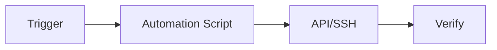

# DevOps Automation

## Overview

- **What is it?** DevOps automation uses Python to script infrastructure, deployments, and operational tasks.
- **Why is it important?** Repeatable automation reduces human error and accelerates releases.
- **Where is it used?** SRE teams, platform engineering, release management, cloud ops.

## Learning Objectives

- **Skills gained:** Practical command of DevOps Automation.
- **Concepts covered:**

- Automate provisioning and config with scripts.
- Integrate with APIs (GitHub, K8s, cloud).
- Add logging and dry-run modes.

- **Expected outcome:** You build reliable ops automation in Python.

## Real World Applications

- Platform teams
- Managed services
- Game live ops
- Enterprise IT

- **Business applications:** Automate workflows, reduce manual errors, accelerate delivery.
- **Career relevance:** Required knowledge for Python roles from junior developer to senior engineer.

## Core Concepts

### Scripted workflow

- **Definition:** Codify runbooks.
- **Visual explanation:** `Scripted workflow` → process → result
- **Practical example:**

```python
def deploy(version):
    return f'deployed {version}'
print(deploy('1.2.3'))
```

### Idempotency

- **Definition:** Safe reruns.
- **Visual explanation:** `Idempotency` → process → result
- **Practical example:**

```python
desired = {'replicas': 3}
current = {'replicas': 3}
print(desired == current)
```

### API automation

- **Definition:** Call control planes.
- **Visual explanation:** `API automation` → process → result
- **Practical example:**

```python
import urllib.request
print(hasattr(urllib.request, 'urlopen'))
```

## Infographic Summary

| Block | Summary |
| --- | --- |
| 📌 Concept | DevOps automation replaces manual clicks with tested code. |
| ⚡ Purpose | Reliable, auditable operations. |
| 🔥 Benefits | Speed, consistency, documentation via code. |
| 🎯 Use Cases | Scale services, rotate certs, cleanup resources. |
| 🚀 Best Practices | Dry-run flag; structured logs; secrets from vault; least privilege. |
| ❌ Common Mistakes | No rollback plan, silent failures, running untested scripts prod-wide. |

## Syntax Guide

### Basic Syntax

```python
if __name__ == '__main__':
    run_playbook()
```

### Standard Structure

```python
parse args -> plan -> apply -> verify
```

### Code Pattern

```python
for host in inventory: ssh_run(host, cmd)
```

## Examples

### Beginner Example

```python
def restart_service(name: str) -> str:
    return f'restarted {name}'
print(restart_service('api'))
```

### Intermediate Example

```python
def ensure_replicas(current: int, desired: int) -> int:
    if current < desired:
        return current + 1
    if current > desired:
        return current - 1
    return current


print(ensure_replicas(2, 3))
```

### Advanced Example

```python
from dataclasses import dataclass


@dataclass
class ChangeRecord:
    action: str
    target: str
    ok: bool


def audit(changes: list[ChangeRecord]) -> list[ChangeRecord]:
    return [c for c in changes if not c.ok]


print(audit([ChangeRecord('scale', 'api', True)]))
```

## Workflow Diagram



---
