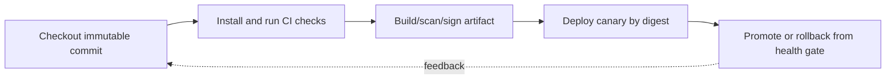

> **Level 3: Advanced** · Topic 38 of 40

[← DevOps Automation](./37-devops-automation.md) · [↑ Level index](../README.md) · [Performance Optimization →](./39-performance-optimization.md)

# CI/CD Pipelines

## Overview
- **What is it?** Continuous integration validates every change in a clean environment, while continuous delivery builds, secures, and promotes one immutable artifact through controlled environments.
- **Why is it important?** A trustworthy pipeline is reproducible, least-privileged, cache-aware, observable, and protected by required checks and deployment approvals.
- **Where is it used?** It supports automated tests, artifact publication, supply-chain evidence, progressive deployment, and rollback.

## Learning Objectives
- Design CI stages for deterministic install, lint, test, build, and scan.
- Use YAML workflows with pinned permissions, matrices, caches, and artifacts.
- Promote one artifact by digest through gated deployment and verification.

## Real World Applications
- Validating Python versions and dependency compatibility on pull requests.
- Building and signing container or package artifacts once.
- Deploying to staging and production with approvals and health gates.

## Core Concepts

### Clean Reproducible CI
- **Definition:** Each CI job starts from declared source, runtime, and locked dependencies so results do not depend on a developer machine.
- **Visual explanation:** `commit + lockfile + runner image → checks → immutable evidence`
- **Practical example:**

```python
from pathlib import Path

required = ["pyproject.toml", "requirements.lock"]
missing = [name for name in required if not Path(name).exists()]
if missing:
    raise SystemExit(f"missing reproducibility inputs: {missing}")
```

### Artifact Promotion
- **Definition:** A build creates one content-addressed artifact; later stages verify and promote that same digest instead of rebuilding environment-specific variants.
- **Visual explanation:** `commit → build/test/scan → artifact digest → stage → production`
- **Practical example:**

```python
from hashlib import sha256
from pathlib import Path

artifact = Path("dist/application.whl")
digest = sha256(artifact.read_bytes()).hexdigest()
print(f"sha256:{digest}")
```

### Deployment Safety
- **Definition:** Protected environments, least-privilege identity, concurrency controls, health checks, and rollback thresholds turn deployment into a bounded experiment.
- **Visual explanation:** `approval → canary → health/SLO gate → expand or rollback`
- **Practical example:**

```python
from dataclasses import dataclass

@dataclass(frozen=True)
class HealthGate:
    maximum_error_rate: float
    maximum_p95_ms: int

    def passes(self, error_rate: float, p95_ms: int) -> bool:
        return error_rate <= self.maximum_error_rate and p95_ms <= self.maximum_p95_ms
```

## Infographic Summary

| Infographic Block | Topic-specific takeaway |
| --- | --- |
| 📌 Concept | Continuous integration validates every change in a clean environment, while continuous delivery builds, secures, and promotes one immutable artifact through controlled environments. |
| ⚡ Purpose | A trustworthy pipeline is reproducible, least-privileged, cache-aware, observable, and protected by required checks and deployment approvals. |
| 🔥 Benefits | Builds the ability to design CI stages for deterministic install, lint, test, build, and scan; it also helps practitioners use YAML workflows with pinned permissions, matrices, caches, and artifacts. |
| 🎯 Use Cases | Validating Python versions and dependency compatibility on pull requests. Building and signing container or package artifacts once. |
| 🚀 Best Practices | Environment approvals and concurrency serialize risky deployments. |
| ❌ Common Mistakes | Ignoring the guardrail “Do not rebuild between staging and production”. |

## Syntax Guide

### Basic Syntax

```python
import os

commit = os.environ.get("GITHUB_SHA", "local")
run_id = os.environ.get("GITHUB_RUN_ID", "manual")
```

### Standard Structure

```python
from pathlib import Path

artifacts = sorted(Path("dist").glob("*"))
if not artifacts:
    raise SystemExit("build produced no artifacts")
```

### Code Pattern

```python
import json
from pathlib import Path

evidence = {"commit": commit, "run_id": run_id, "artifacts": [p.name for p in artifacts]}
Path("build-evidence.json").write_text(json.dumps(evidence, indent=2))
```

#### Deployment Artifact

```yaml
name: ci
on:
  pull_request:
  push:
    branches: [main]
permissions:
  contents: read
jobs:
  test:
    runs-on: ubuntu-latest
    strategy:
      matrix:
        python: ["3.12", "3.13"]
    steps:
      - uses: actions/checkout@v4
      - uses: actions/setup-python@v5
        with:
          python-version: ${{ matrix.python }}
          cache: pip
      - run: python -m pip install -r requirements.lock
      - run: python -m pytest -q
```

## Examples

### Beginner Example

```python
import subprocess

subprocess.run(["python", "-m", "pytest", "-q"], check=True, timeout=600)
```

### Intermediate Example

```python
import subprocess
from pathlib import Path

subprocess.run(["python", "-m", "build"], check=True, timeout=600)
distributions = [str(path) for path in Path("dist").iterdir()]
subprocess.run(
    ["python", "-m", "twine", "check", *distributions],
    check=True,
    timeout=120,
)
```

### Advanced Example

```python
gate = HealthGate(maximum_error_rate=0.01, maximum_p95_ms=300)
measurements = {"error_rate": 0.004, "p95_ms": 180}
if not gate.passes(**measurements):
    raise SystemExit("rollback: canary health gate failed")
print("promote canary")
```

## Workflow Diagram



---

[← DevOps Automation](./37-devops-automation.md) · [↑ Level index](../README.md) · [Performance Optimization →](./39-performance-optimization.md)
