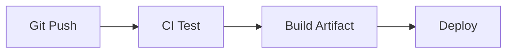

# CI/CD Pipelines

## Overview

- **What is it?** CI/CD pipelines automatically test, build, and deploy code on each change.
- **Why is it important?** Fast feedback and repeatable releases reduce production incidents.
- **Where is it used?** GitHub Actions, GitLab CI, Jenkins, cloud deploy pipelines.

## Learning Objectives

- **Skills gained:** Practical command of CI/CD Pipelines.
- **Concepts covered:**

- Configure test/lint/build stages.
- Cache dependencies in CI.
- Promote artifacts through environments.

- **Expected outcome:** You implement Python CI/CD workflows with gates and artifacts.

## Real World Applications

- Every software org
- Open source
- Regulated industries
- Mobile backends

- **Business applications:** Automate workflows, reduce manual errors, accelerate delivery.
- **Career relevance:** Required knowledge for Python roles from junior developer to senior engineer.

## Core Concepts

### CI

- **Definition:** Continuous integration tests.
- **Visual explanation:** `CI` → process → result
- **Practical example:**

```python
steps = ['checkout', 'test', 'lint']
print(steps.index('test'))
```

### CD

- **Definition:** Continuous delivery/deploy.
- **Visual explanation:** `CD` → process → result
- **Practical example:**

```python
envs = ['dev', 'staging', 'prod']
print(envs[-1])
```

### Artifacts

- **Definition:** Built wheels/images.
- **Visual explanation:** `Artifacts` → process → result
- **Practical example:**

```python
artifact = 'dist/app-1.0.whl'
print(artifact.endswith('.whl'))
```

## Infographic Summary

| Block | Summary |
| --- | --- |
| 📌 Concept | Pipelines encode quality gates before production. |
| ⚡ Purpose | Ship safely and frequently. |
| 🔥 Benefits | Automation, audit trail, faster MTTR. |
| 🎯 Use Cases | Run pytest on PR, build Docker on main, deploy to staging. |
| 🚀 Best Practices | Fail fast; pin actions; secrets in CI vault; matrix Python versions. |
| ❌ Common Mistakes | No tests in CI, flaky pipelines ignored, deploying without migration plan. |

## Syntax Guide

### Basic Syntax

```python
steps = ['pytest', 'python', '-m', 'build']
print(steps[0])
```

### Standard Structure

```python
trigger -> lint/test -> build -> deploy
```

### Code Pattern

```python
on: pull_request -> jobs: test
```

## Examples

### Beginner Example

```python
pipeline = ['lint', 'test']
print('test' in pipeline)
```

### Intermediate Example

```python
def should_deploy(branch: str, tests_passed: bool) -> bool:
    return branch == 'main' and tests_passed


print(should_deploy('main', True))
```

### Advanced Example

```python
def promotion_gate(metrics: dict) -> bool:
    return metrics.get('error_rate', 1) < 0.01 and metrics.get('p95_ms', 999) < 300


print(promotion_gate({'error_rate': 0.001, 'p95_ms': 120}))
```

## Workflow Diagram



---
