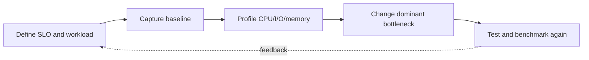

> **Level 3: Advanced** · Topic 39 of 40

[← CI/CD Pipelines](./38-ci-cd-pipelines.md) · [↑ Level index](../README.md) · [System Design with Python →](./40-system-design-with-python.md)

# Performance Optimization

## Overview
- **What is it?** Performance optimization is an evidence-driven process: define a user-visible target, profile the real workload, fix the dominant bottleneck, and verify the trade-off.
- **Why is it important?** Python offers wall-clock timing, deterministic and sampling CPU profilers, allocation tracing, benchmark tools, and optimized built-ins.
- **Where is it used?** It is used to reduce latency, increase throughput, lower memory and compute cost, and protect service-level objectives.

## Learning Objectives
- Establish representative baselines and profile before changing code.
- Interpret CPU, wall-time, allocation, and I/O evidence correctly.
- Apply algorithmic, data-structure, batching, caching, and vectorization improvements.

## Real World Applications
- Finding hot functions in request, batch, and data-processing workloads.
- Reducing allocation pressure and peak memory in long-lived processes.
- Comparing an optimization against regression-safe benchmarks.

## Core Concepts

### Baseline Before Optimization
- **Definition:** A baseline records representative inputs, environment, warm-up, latency distribution, throughput, and resource use before any optimization.
- **Visual explanation:** `performance goal → reproducible workload → baseline distribution`
- **Practical example:**

```python
from timeit import repeat

samples = repeat(
    "sum(range(10_000))",
    repeat=7,
    number=1_000,
)
print(min(samples), sorted(samples)[len(samples) // 2])
```

### Profile the Bottleneck
- **Definition:** `cProfile` attributes deterministic call time and `tracemalloc` attributes Python allocations; both guide investigation but add measurement overhead.
- **Visual explanation:** `representative run → CPU/allocation profile → dominant call site`
- **Practical example:**

```python
import cProfile
import pstats

profiler = cProfile.Profile()
profiler.enable()
result = sum(value * value for value in range(100_000))
profiler.disable()
pstats.Stats(profiler).sort_stats("cumulative").print_stats(5)
```

### Optimize and Re-verify
- **Definition:** Prefer algorithmic improvements and less work before micro-optimizations, then rerun correctness tests and the same benchmark to detect regressions.
- **Visual explanation:** `profile hotspot → change one cause → correctness → benchmark comparison`
- **Practical example:**

```python
def repeated_membership(items: list[int], queries: list[int]) -> list[bool]:
    index = set(items)
    return [query in index for query in queries]

assert repeated_membership([1, 2, 3], [2, 4]) == [True, False]
```

## Infographic Summary

| Infographic Block | Topic-specific takeaway |
| --- | --- |
| 📌 Concept | Performance optimization is an evidence-driven process: define a user-visible target, profile the real workload, fix the dominant bottleneck, and verify the trade-off. |
| ⚡ Purpose | Python offers wall-clock timing, deterministic and sampling CPU profilers, allocation tracing, benchmark tools, and optimized built-ins. |
| 🔥 Benefits | Builds the ability to establish representative baselines and profile before changing code; it also helps practitioners interpret CPU, wall-time, allocation, and I/O evidence correctly. |
| 🎯 Use Cases | Finding hot functions in request, batch, and data-processing workloads. Reducing allocation pressure and peak memory in long-lived processes. |
| 🚀 Best Practices | Verify correctness and benchmark against the same baseline. |
| ❌ Common Mistakes | Ignoring the guardrail “Reject optimizations that shift cost beyond the actual SLO”. |

## Syntax Guide

### Basic Syntax

```python
from time import perf_counter

started = perf_counter()
result = sum(range(1_000_000))
elapsed = perf_counter() - started
```

### Standard Structure

```python
import cProfile

cProfile.run("sum(range(1_000_000))", sort="cumulative")
```

### Code Pattern

```python
import tracemalloc

tracemalloc.start()
before = tracemalloc.take_snapshot()
values = [str(number) for number in range(10_000)]
after = tracemalloc.take_snapshot()
changes = after.compare_to(before, "lineno")
tracemalloc.stop()
```

## Examples

### Beginner Example

```python
from timeit import timeit

duration = timeit("'-'.join(['a', 'b', 'c'])", number=100_000)
print(duration)
```

### Intermediate Example

```python
def duplicate_pairs_slow(values: list[int]) -> int:
    return sum(left == right for i, left in enumerate(values) for right in values[i + 1:])

def duplicate_pairs(values: list[int]) -> int:
    from collections import Counter

    return sum(count * (count - 1) // 2 for count in Counter(values).values())

assert duplicate_pairs_slow([1, 2, 1, 1]) == duplicate_pairs([1, 2, 1, 1])
```

### Advanced Example

```python
from functools import lru_cache
from timeit import repeat

@lru_cache(maxsize=1_024)
def parse_rule(text: str) -> tuple[str, str]:
    key, separator, value = text.partition("=")
    if not separator:
        raise ValueError("rule requires '='")
    return key.strip(), value.strip()

baseline = min(repeat(lambda: parse_rule("mode = safe"), repeat=5, number=10_000))
print(parse_rule.cache_info(), baseline)
```

## Workflow Diagram



---

[← CI/CD Pipelines](./38-ci-cd-pipelines.md) · [↑ Level index](../README.md) · [System Design with Python →](./40-system-design-with-python.md)
