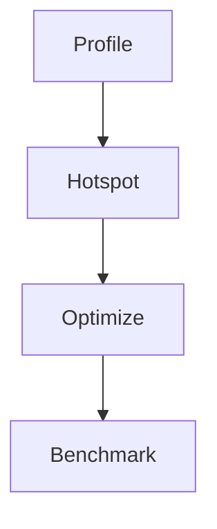

# Performance Optimization

## Overview

- **What is it?** Performance optimization improves latency, throughput, and resource usage of Python programs.
- **Why is it important?** Slow software increases cost and hurts user experience at scale.
- **Where is it used?** API hot paths, ETL, ML inference, high-QPS services.

## Learning Objectives

- **Skills gained:** Practical command of Performance Optimization.
- **Concepts covered:**

- Profile with cProfile and py-spy.
- Apply algorithmic and vectorization wins.
- Use caching and async I/O appropriately.

- **Expected outcome:** You measure first and apply targeted optimizations.

## Real World Applications

- Ad exchanges
- Search
- Fintech trading tools
- Streaming

- **Business applications:** Automate workflows, reduce manual errors, accelerate delivery.
- **Career relevance:** Required knowledge for Python roles from junior developer to senior engineer.

## Core Concepts

### Profiling

- **Definition:** Find hotspots.
- **Visual explanation:** `Profiling` → process → result
- **Practical example:**

```python
import cProfile
cProfile.run('sum(range(1000))')
```

### Big-O

- **Definition:** Scale with input size.
- **Visual explanation:** `Big-O` → process → result
- **Practical example:**

```python
def linear(n):
    return sum(range(n))
print(linear(10))
```

### Caching

- **Definition:** Memoize pure functions.
- **Visual explanation:** `Caching` → process → result
- **Practical example:**

```python
from functools import lru_cache
@lru_cache
def fib(n):
    return n if n < 2 else fib(n-1)+fib(n-2)
print(fib(10))
```

## Infographic Summary

| Block | Summary |
| --- | --- |
| 📌 Concept | Optimize bottlenecks proven by measurement. |
| ⚡ Purpose | Meet SLAs and reduce infrastructure cost. |
| 🔥 Benefits | Lower latency, higher throughput, happier users. |
| 🎯 Use Cases | API caching, batch tuning, NumPy vectorization. |
| 🚀 Best Practices | Benchmark before/after; load test; avoid premature optimization. |
| ❌ Common Mistakes | Optimizing cold code, micro-opts over algorithms, no profiling. |

## Syntax Guide

### Basic Syntax

```python
from functools import lru_cache


@lru_cache(maxsize=1024)
def expensive(n: int) -> int:
    return n * n


print(expensive(3))
```

### Standard Structure

```python
profile -> hypothesize -> optimize -> verify
```

### Code Pattern

```python
optimizations = ['cache', 'vectorize', 'async_io']
print(len(optimizations))
```

## Examples

### Beginner Example

```python
import time
t0 = time.perf_counter()
sum(range(100000))
print(time.perf_counter() - t0 < 1)
```

### Intermediate Example

```python
from functools import lru_cache


@lru_cache(maxsize=None)
def slow(n: int) -> int:
    return sum(range(n))


print(slow(1000) == slow(1000))
```

### Advanced Example

```python
import cProfile
import pstats
from io import StringIO

buf = StringIO()
cProfile.run('sum(i*i for i in range(1000))', buf)
stats = pstats.Stats(buf)
print(stats.total_calls > 0)
```

## Workflow Diagram



---
