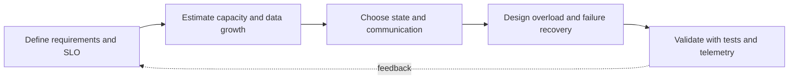

> **Level 3: Advanced** · Topic 40 of 40

[← Performance Optimization](./39-performance-optimization.md) · [↑ Level index](../README.md)

# System Design with Python

## Overview
- **What is it?** System design translates functional requirements and service-level objectives into components, data flows, capacity assumptions, consistency rules, and failure handling.
- **Why is it important?** Python is well suited to orchestration and service logic, but architecture must account for runtime concurrency, deployment topology, storage semantics, and operational feedback.
- **Where is it used?** It is used for scalable APIs, job platforms, event systems, data products, and senior engineering design decisions.

## Learning Objectives
- Turn requirements into capacity estimates, interfaces, and data models.
- Choose caching, partitioning, queues, consistency, and resilience deliberately.
- Design observability, overload behavior, migration, and recovery before launch.

## Real World Applications
- Designing read-heavy content services with bounded stale caching.
- Building asynchronous job systems with idempotent execution.
- Scaling stateful data while preserving ownership and recovery guarantees.

## Core Concepts

### Requirements and Capacity
- **Definition:** A design begins with workload shape, latency and availability targets, data volume, growth, read/write ratio, object size, and retention.
- **Visual explanation:** `requirements + estimates → bottlenecks → component budget`
- **Practical example:**

```python
from dataclasses import dataclass

@dataclass(frozen=True)
class Workload:
    requests_per_second: int
    average_payload_bytes: int

    @property
    def ingress_bytes_per_second(self) -> int:
        return self.requests_per_second * self.average_payload_bytes
```

### State, Caching, and Partitioning
- **Definition:** Caches trade freshness for latency and load, while partitioning distributes authoritative state by a stable key and requires rebalancing strategy.
- **Visual explanation:** `request → cache → owner partition → replicated durable state`
- **Practical example:**

```python
from hashlib import blake2b

def shard_for(key: str, shard_count: int) -> int:
    if shard_count < 1:
        raise ValueError("shard_count must be positive")
    digest = blake2b(key.encode(), digest_size=8).digest()
    return int.from_bytes(digest, "big") % shard_count
```

### Overload and Failure Design
- **Definition:** A resilient system bounds queues and concurrency, applies deadlines, sheds excess work, makes retries idempotent, and degrades noncritical features.
- **Visual explanation:** `admission control → bounded work → dependency budgets → fallback or result`
- **Practical example:**

```python
from asyncio import Semaphore

class AdmissionController:
    def __init__(self, capacity: int) -> None:
        self._slots = Semaphore(capacity)

    async def run(self, operation):
        async with self._slots:
            return await operation()
```

## Infographic Summary

| Infographic Block | Topic-specific takeaway |
| --- | --- |
| 📌 Concept | System design translates functional requirements and service-level objectives into components, data flows, capacity assumptions, consistency rules, and failure handling. |
| ⚡ Purpose | Python is well suited to orchestration and service logic, but architecture must account for runtime concurrency, deployment topology, storage semantics, and operational feedback. |
| 🔥 Benefits | Builds the ability to turn requirements into capacity estimates, interfaces, and data models; it also helps practitioners choose caching, partitioning, queues, consistency, and resilience deliberately. |
| 🎯 Use Cases | Designing read-heavy content services with bounded stale caching. Building asynchronous job systems with idempotent execution. |
| 🚀 Best Practices | Partitioning needs stable ownership, rebalancing, and hotspot policy. |
| ❌ Common Mistakes | Ignoring the guardrail “Document failure modes, recovery objectives, and migration paths”. |

## Syntax Guide

### Basic Syntax

```python
from dataclasses import dataclass

@dataclass(frozen=True)
class SLO:
    availability: float
    p95_latency_ms: int
```

### Standard Structure

```python
def cache_key(namespace: str, version: int, identifier: str) -> str:
    return f"{namespace}:v{version}:{identifier}"
```

### Code Pattern

```python
from collections import deque

class BoundedBuffer:
    def __init__(self, capacity: int) -> None:
        self._items = deque(maxlen=capacity)

    def offer(self, item: object) -> bool:
        if len(self._items) == self._items.maxlen:
            return False
        self._items.append(item)
        return True
```

## Examples

### Beginner Example

```python
workload = Workload(requests_per_second=2_000, average_payload_bytes=4_096)
print(workload.ingress_bytes_per_second)
```

### Intermediate Example

```python
users = ["user-a", "user-b", "user-c"]
assignments = {user: shard_for(user, shard_count=16) for user in users}
print(assignments)
```

### Advanced Example

```python
from dataclasses import dataclass
from time import monotonic

@dataclass
class CacheEntry:
    value: object
    expires_at: float

class TTLCache:
    def __init__(self) -> None:
        self._entries: dict[str, CacheEntry] = {}

    def get(self, key: str) -> object | None:
        entry = self._entries.get(key)
        if entry is None or entry.expires_at <= monotonic():
            self._entries.pop(key, None)
            return None
        return entry.value

    def put(self, key: str, value: object, ttl: float) -> None:
        self._entries[key] = CacheEntry(value, monotonic() + ttl)
```

## Workflow Diagram



---

[← Performance Optimization](./39-performance-optimization.md) · [↑ Level index](../README.md)
