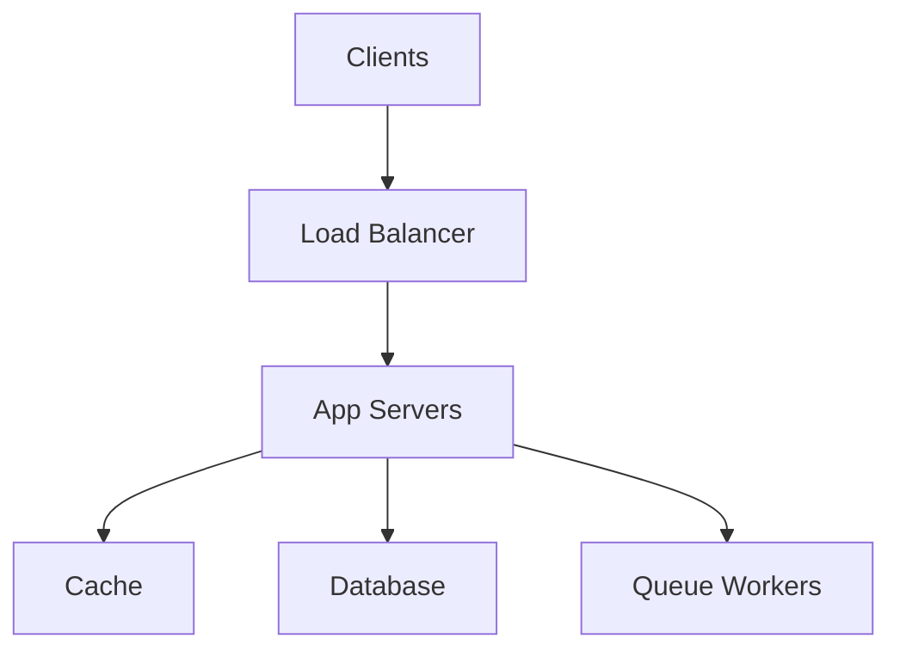

# System Design with Python

## Overview

- **What is it?** System design with Python plans scalable architectures using services, queues, caches, and databases.
- **Why is it important?** Senior engineers must translate requirements into reliable large-scale designs.
- **Where is it used?** Architecture reviews, interviews, greenfield platforms, rewrites.

## Learning Objectives

- **Skills gained:** Practical command of System Design with Python.
- **Concepts covered:**

- Estimate capacity and define APIs.
- Choose databases, caches, and queues.
- Plan observability and failure modes.

- **Expected outcome:** You draft end-to-end system designs implementable in Python stacks.

## Real World Applications

- Big tech
- High-growth startups
- Consulting
- Platform engineering

- **Business applications:** Automate workflows, reduce manual errors, accelerate delivery.
- **Career relevance:** Required knowledge for Python roles from junior developer to senior engineer.

## Core Concepts

### Load balancing

- **Definition:** Distribute traffic.
- **Visual explanation:** `Load balancing` → process → result
- **Practical example:**

```python
servers = ['a', 'b', 'b']
print(max(set(servers), key=servers.count))
```

### Caching

- **Definition:** Reduce read load.
- **Visual explanation:** `Caching` → process → result
- **Practical example:**

```python
cache = {}
def get(key):
    return cache.setdefault(key, 'value')
print(get('k'))
```

### Queue

- **Definition:** Async decouple.
- **Visual explanation:** `Queue` → process → result
- **Practical example:**

```python
from collections import deque
q = deque(['job'])
print(q.popleft())
```

## Infographic Summary

| Block | Summary |
| --- | --- |
| 📌 Concept | Design balances latency, throughput, consistency, and cost. |
| ⚡ Purpose | Build systems that meet scale and reliability goals. |
| 🔥 Benefits | Clear roadmap, risk reduction, aligned teams. |
| 🎯 Use Cases | URL shortener, feed system, rate limiter, chat. |
| 🚀 Best Practices | Start simple; define SLIs/SLOs; design for failure; document tradeoffs. |
| ❌ Common Mistakes | Over-engineering day one, single DB bottleneck, no monitoring plan. |

## Syntax Guide

### Basic Syntax

```python
# API -> service -> cache/db -> async workers
```

### Standard Structure

```python
clients -> LB -> app tier -> data tier -> async workers
```

### Code Pattern

```python
cache = {}
def read(key):
    return cache.get(key, 'miss')


print(read('user:1'))
```

## Examples

### Beginner Example

```python
components = ['api', 'db', 'cache']
print(len(components))
```

### Intermediate Example

```python
class RateLimiter:
    def __init__(self, limit: int):
        self.limit = limit
        self.count = 0

    def allow(self) -> bool:
        if self.count >= self.limit:
            return False
        self.count += 1
        return True


rl = RateLimiter(2)
print(rl.allow(), rl.allow(), rl.allow())
```

### Advanced Example

```python
from dataclasses import dataclass


@dataclass
class DesignDoc:
    service: str
    rps: int
    datastore: str
    notes: str


doc = DesignDoc('url-shortener', rps=10_000, datastore='redis+dynamodb', notes='cache hot keys')
print(doc.service, doc.rps)
```

## Workflow Diagram



---
