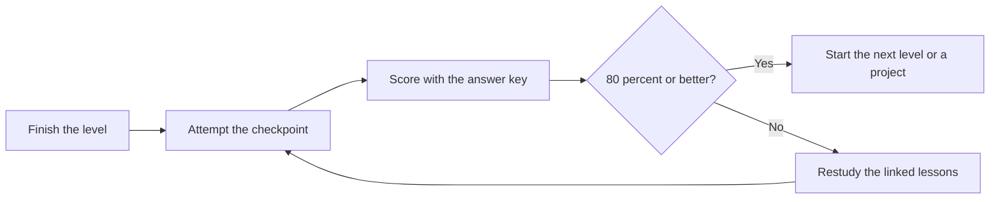

# Checkpoint Assessments

[← Knowledge base](../README.md) · [Glossary](../Glossary/README.md)

Take a checkpoint after you finish a level. Answer from memory, then open the answer key and score explanations, not just the final value.

## Checkpoints

| Level | Questions | Answer key | Take it after |
| --- | --- | --- | --- |
| Beginner | [Checkpoint](./01-beginner-checkpoint.md) | [Answers](./01-beginner-answers.md) | [Basic Project Structure](../Beginner/35-basic-project-structure.md) |
| Intermediate | [Checkpoint](./02-intermediate-checkpoint.md) | [Answers](./02-intermediate-answers.md) | [CLI Applications](../Intermediate/35-cli-applications.md) |
| Advanced | [Checkpoint](./03-advanced-checkpoint.md) | [Answers](./03-advanced-answers.md) | [System Design with Python](../Advanced/40-system-design-with-python.md) |

## Scoring

- **12/12:** Teach the level to someone else, then start a [project brief](../Projects/).
- **10–11:** Review the two missed lessons, then move on.
- **Below 10:** Repeat the linked lessons and retake the checkpoint in two days.

Each checkpoint has eight short-answer items and four code-reading items. Write the code-reading answers before you run the snippets.
