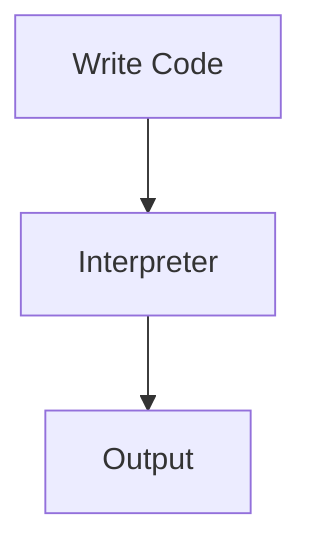

# Introduction to Python

## Overview

- **What is it?** Python is a high-level, interpreted language prized for readable syntax and a vast ecosystem.
- **Why is it important?** It powers web backends, data science, automation, AI, and DevOps with one of the largest communities.
- **Where is it used?** Startups, enterprises, research labs, fintech, healthcare analytics, and cloud platforms.

## Learning Objectives

- **Skills gained:** Practical command of Introduction to Python.
- **Concepts covered:**

- Explain Python's design philosophy and ecosystem.
- Compare Python to other languages for common workloads.
- Identify domains where Python excels.

- **Expected outcome:** You can explain why Python fits a project and where it belongs in a tech stack.

## Real World Applications

- Web services
- Data pipelines
- ML platforms
- Security automation

- **Business applications:** Automate workflows, reduce manual errors, accelerate delivery.
- **Career relevance:** Required knowledge for Python roles from junior developer to senior engineer.

## Core Concepts

### Interpreted Execution

- **Definition:** Source runs via the interpreter.
- **Visual explanation:** `Interpreted Execution` → process → result
- **Practical example:**

```python
print('Hello, Python!')
```

### Standard Library

- **Definition:** Rich modules ship with Python.
- **Visual explanation:** `Standard Library` → process → result
- **Practical example:**

```python
import json
print(json.dumps({'ok': True}))
```

### Dynamic Typing

- **Definition:** Types determined at runtime.
- **Visual explanation:** `Dynamic Typing` → process → result
- **Practical example:**

```python
x = 10
x = 'ten'
print(x)
```

## Infographic Summary

| Block | Summary |
| --- | --- |
| 📌 Concept | Python is interpreted, dynamically typed, and multi-paradigm. |
| ⚡ Purpose | Ship solutions quickly with readable code and strong libraries. |
| 🔥 Benefits | Fast prototyping, huge community, cross-platform, excellent for teams. |
| 🎯 Use Cases | APIs, ETL, notebooks, scripting, AI/ML, test automation. |
| 🚀 Best Practices | Follow PEP 8, use virtual environments, prefer clarity over cleverness. |
| ❌ Common Mistakes | Assuming Python is slow for every task, ignoring version pins, skipping tests. |

## Syntax Guide

### Basic Syntax

```python
print("Hello, Python!")
```

### Standard Structure

```python
def main():
    print("Learning Python")


if __name__ == "__main__":
    main()
```

### Code Pattern

```python
import json
print(json.dumps({'status': 'ok'}))
```

## Examples

### Beginner Example

```python
print("Python is fun!")
```

### Intermediate Example

```python
domains = ["web", "data", "automation", "ai"]
for domain in domains:
    print(f"Python powers {domain}")
```

### Advanced Example

```python
from dataclasses import dataclass


@dataclass(frozen=True)
class LanguageProfile:
    name: str
    typing: str


print(LanguageProfile("Python", "dynamic"))
```

## Workflow Diagram



---
