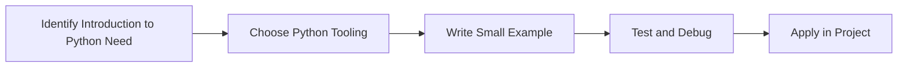

> **Level 1: Beginner** · Topic 1 of 35

[↑ Level index](../README.md) · [Installing Python →](./02-installing-python.md)

# Introduction to Python

## Overview
- **What is it?** Python is a high-level, readable, general-purpose programming language used to build scripts, applications, data workflows, automation, and AI systems.
- **Why is it important?** Turn human-readable ideas into executable instructions quickly while keeping code maintainable.
- **Where is it used?** Learning labs, team onboarding, automation, and product engineering.

## Learning Objectives
- Gain the practical skill to explain, write, debug, and review introduction to python code.
- Cover the vocabulary, syntax, workflow, edge cases, and professional habits behind introduction to python.
- Expected outcome: you can use introduction to python in a small project and recognize when it belongs in production code.

## Real World Applications
- **Industry use cases:** Learning labs, team onboarding, automation, and product engineering.
- **Business applications:** Reduce manual work, improve reliability, support reporting, automate decisions, and ship maintainable features.
- **Career relevance:** Supports Python developer, backend engineer, data engineer, AI engineer, DevOps engineer, QA automation, and cybersecurity automation roles.

## Core Concepts

### Mental Model
- **Definition:** The main idea that gives introduction to python its structure and purpose inside a Python program.
- **Visual explanation:** `problem -> Introduction to Python model -> clear code`
- **Practical example:**

```python
apply_introduction_to_python_label = "Introduction to Python"
print(apply_introduction_to_python_label)
```

### Execution Flow
- **Definition:** The ordered steps Python follows when introduction to python code is created, executed, or integrated.
- **Visual explanation:** `input -> Python operation -> result -> feedback`
- **Practical example:**

```python
topic = "Introduction to Python"
print(f"Learning {topic}")
```

### Quality Rule
- **Definition:** The reliability habit that keeps introduction to python understandable, testable, secure, and maintainable.
- **Visual explanation:** `working code -> validation -> production confidence`
- **Practical example:**

```python
def summarize_introduction_to_python(items: list[str]) -> dict[str, int]:
    return {"topic_count": len(items), "unique_count": len(set(items))}

print(summarize_introduction_to_python(["learn", "practice", "learn"]))
```

## Infographic Summary

| Infographic Block | Key Message |
| --- | --- |
| 📌 Concept | Introduction to Python belongs to the fundamental Python practice part of Python mastery. |
| ⚡ Purpose | Turn human-readable ideas into executable instructions quickly while keeping code maintainable. |
| 🔥 Benefits | Readable syntax, strong ecosystem, cross-platform support, and fast learning curve. |
| 🎯 Use Cases | Learning labs, team onboarding, automation, and product engineering. |
| 🚀 Best Practices | Prefer readable names, small examples, explicit errors, tests, documentation, and version-aware choices. |
| ❌ Common Mistakes | Copying code without understanding it, ignoring edge cases, skipping validation, and mixing unrelated responsibilities. |

## Syntax Guide

### Basic Syntax

```python
topic_name = "Introduction to Python"
print(topic_name)
```

### Standard Structure

```python
def apply_introduction_to_python(value):
    """Apply the Introduction to Python concept to one value."""
    return value

result = apply_introduction_to_python("practice")
print(result)
```

### Code Pattern

```python
# 1. Identify the Introduction to Python problem
# 2. Apply the correct Python structure
# 3. Validate the result with tests or output
```

## Examples

### Beginner Example

```python
topic = "Introduction to Python"
print(f"Learning {topic}")
```

### Intermediate Example

```python
def summarize_introduction_to_python(items: list[str]) -> dict[str, int]:
    return {"topic_count": len(items), "unique_count": len(set(items))}

print(summarize_introduction_to_python(["learn", "practice", "learn"]))
```

### Advanced Example

```python
from dataclasses import dataclass

@dataclass(frozen=True)
class IntroductionToPythonOutcome:
    topic: str
    evidence: str

outcome = IntroductionToPythonOutcome("Introduction to Python", "production-ready understanding")
print(outcome)
```

## Workflow Diagram




---

---

[↑ Level index](../README.md) · [Installing Python →](./02-installing-python.md)
