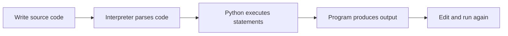

> **Level 1: Beginner** · Topic 1 of 35

[↑ Level index](../README.md) · [Installing Python →](./02-installing-python.md)

# Introduction to Python

## Overview
- **What is it?** Python is a high-level, general-purpose language whose readable source code is executed by a Python interpreter.
- **Why is it important?** Its small syntax and large standard library let beginners turn ideas into working programs quickly.
- **Where is it used?** Python powers automation, web services, data analysis, testing, education, and machine learning.

## Learning Objectives
- Distinguish source code, the interpreter, and program output.
- Run a Python statement and read a simple traceback.
- Recognize Python's strengths and the trade-off of choosing a general-purpose language.

## Real World Applications
- Automate repetitive file or reporting tasks.
- Prototype web, data, and scientific ideas.
- Write readable utilities that teams can maintain.

## Core Concepts

### Interpreter and source
- **Definition:** A `.py` file contains text; the interpreter parses and executes that text as instructions.
- **Visual explanation:** `program.py -> Python interpreter -> effects and output`
- **Practical example:** A first statement sends text to standard output.

```python
print("Hello, Python!")
```

### Values and operations
- **Definition:** Python programs create values and combine them with operations such as addition or function calls.
- **Visual explanation:** `values -> expression -> new value`
- **Practical example:** A numeric expression is evaluated before it is printed.

```python
minutes = 2 * 60
print(minutes)
```

### Readable composition
- **Definition:** Larger programs combine named data, decisions, repetition, and reusable functions.
- **Visual explanation:** `data + control flow + functions -> program`
- **Practical example:** A function turns a name into a reusable greeting.

```python
def greet(name):
    return f"Welcome, {name}!"

print(greet("Mina"))
```

## Infographic Summary

| Infographic Block | Topic-Specific Takeaway |
| --- | --- |
| 📌 Concept | Python is a high-level, general-purpose language whose readable source code is executed by a Python interpreter. |
| ⚡ Purpose | Turn readable source code into executable instructions and useful program output. |
| 🔥 Benefits | Its small syntax and large standard library let beginners turn ideas into working programs quickly. |
| 🎯 Use Cases | Python powers automation, web services, data analysis, testing, education, and machine learning. |
| 🚀 Best Practices | Start with a small runnable program, then change one thing and observe the result. |
| ❌ Common Mistakes | Treating Python as only a calculator instead of learning how values and statements compose. |

## Syntax Guide

### Basic Syntax

```python
print("Python is running")
```

### Standard Structure

```python
language = "Python"
version = 3
print(f"{language} {version}")
```

### Code Pattern

```python
def describe(topic):
    message = f"Learning {topic}"
    return message

print(describe("Python"))
```

## Examples

### Beginner Example

```python
print("Hello, world!")
```

### Intermediate Example

```python
name = "Ari"
hours = 3
print(f"{name} practiced Python for {hours} hours.")
```

### Advanced Example

```python
def progress_report(name, completed, total):
    percent = completed / total * 100
    return f"{name}: {percent:.0f}% complete"

print(progress_report("Ari", 7, 10))
```

## Workflow Diagram



---

[↑ Level index](../README.md) · [Installing Python →](./02-installing-python.md)
