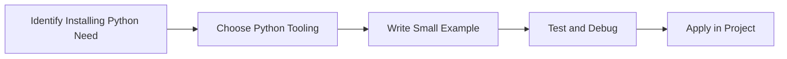

> **Level 1: Beginner** · Topic 2 of 35

[← Introduction to Python](./01-introduction-to-python.md) · [↑ Level index](../README.md) · [IDE Setup →](./03-ide-setup.md)

# Installing Python

## Overview
- **What is it?** Installing Python means placing the interpreter, package tools, and command-line entry points on your computer so Python code can run.
- **Why is it important?** Create a reliable local runtime for scripts, projects, notebooks, and tooling.
- **Where is it used?** Learning labs, team onboarding, automation, and product engineering.

## Learning Objectives
- Gain the practical skill to explain, write, debug, and review installing python code.
- Cover the vocabulary, syntax, workflow, edge cases, and professional habits behind installing python.
- Expected outcome: you can use installing python in a small project and recognize when it belongs in production code.

## Real World Applications
- **Industry use cases:** Learning labs, team onboarding, automation, and product engineering.
- **Business applications:** Reduce manual work, improve reliability, support reporting, automate decisions, and ship maintainable features.
- **Career relevance:** Supports Python developer, backend engineer, data engineer, AI engineer, DevOps engineer, QA automation, and cybersecurity automation roles.

## Core Concepts

### Mental Model
- **Definition:** The main idea that gives installing python its structure and purpose inside a Python program.
- **Visual explanation:** `problem -> Installing Python model -> clear code`
- **Practical example:**

```python
apply_installing_python_label = "Installing Python"
print(apply_installing_python_label)
```

### Execution Flow
- **Definition:** The ordered steps Python follows when installing python code is created, executed, or integrated.
- **Visual explanation:** `input -> Python operation -> result -> feedback`
- **Practical example:**

```python
import platform
print(platform.python_version())
```

### Quality Rule
- **Definition:** The reliability habit that keeps installing python understandable, testable, secure, and maintainable.
- **Visual explanation:** `working code -> validation -> production confidence`
- **Practical example:**

```python
import sys

if sys.version_info < (3, 12):
    raise RuntimeError("Python 3.12 or newer is recommended")
print("Python version is ready")
```

## Infographic Summary

| Infographic Block | Key Message |
| --- | --- |
| 📌 Concept | Installing Python belongs to the fundamental Python practice part of Python mastery. |
| ⚡ Purpose | Create a reliable local runtime for scripts, projects, notebooks, and tooling. |
| 🔥 Benefits | Repeatable execution, access to pip packages, and compatibility with editors and CI systems. |
| 🎯 Use Cases | Learning labs, team onboarding, automation, and product engineering. |
| 🚀 Best Practices | Prefer readable names, small examples, explicit errors, tests, documentation, and version-aware choices. |
| ❌ Common Mistakes | Copying code without understanding it, ignoring edge cases, skipping validation, and mixing unrelated responsibilities. |

## Syntax Guide

### Basic Syntax

```python
import sys
print(sys.version)
print(sys.executable)
```

### Standard Structure

```python
def apply_installing_python(value):
    """Apply the Installing Python concept to one value."""
    return value

result = apply_installing_python("practice")
print(result)
```

### Code Pattern

```python
# 1. Identify the Installing Python problem
# 2. Apply the correct Python structure
# 3. Validate the result with tests or output
```

## Examples

### Beginner Example

```python
import platform
print(platform.python_version())
```

### Intermediate Example

```python
import sys

if sys.version_info < (3, 12):
    raise RuntimeError("Python 3.12 or newer is recommended")
print("Python version is ready")
```

### Advanced Example

```python
from pathlib import Path
import sys

project = Path.cwd()
print({"python": sys.version.split()[0], "project": project.name})
```

## Workflow Diagram




---

---

[← Introduction to Python](./01-introduction-to-python.md) · [↑ Level index](../README.md) · [IDE Setup →](./03-ide-setup.md)
