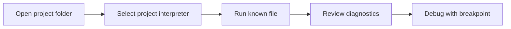

> **Level 1: Beginner** · Topic 3 of 35

[← Installing Python](./02-installing-python.md) · [↑ Level index](../README.md) · [Python Syntax →](./04-python-syntax.md)

# IDE Setup

## Overview
- **What is it?** IDE setup connects an editor to a chosen Python interpreter, terminal, formatter, linter, and debugger.
- **Why is it important?** Correct configuration shortens the write-run-inspect cycle and exposes mistakes early.
- **Where is it used?** The same workflow supports lessons, scripts, team projects, and remote development.

## Learning Objectives
- Select the intended interpreter for a workspace.
- Run a file and pause execution with a breakpoint.
- Separate editor assistance from behavior enforced by Python itself.

## Real World Applications
- Navigate and edit multi-file projects.
- Inspect variables while troubleshooting.
- Apply consistent formatting and diagnostics across a team.

## Core Concepts

### Interpreter selection
- **Definition:** The IDE must launch the same Python environment that owns the project's dependencies.
- **Visual explanation:** `workspace -> selected interpreter -> run and debug`
- **Practical example:** The running file can display the selected executable.

```python
import sys
print(sys.executable)
```

### Feedback tools
- **Definition:** A formatter changes layout, while a linter reports suspicious or inconsistent code.
- **Visual explanation:** `source -> formatter and linter -> clearer source`
- **Practical example:** Type annotations give IDEs useful information without forcing runtime types.

```python
def total(items: list[float]) -> float:
    return sum(items)

print(total([2.5, 3.0]))
```

### Debugger state
- **Definition:** A debugger pauses at a breakpoint so the current call stack and variable values can be inspected.
- **Visual explanation:** `breakpoint -> paused frame -> inspect -> step or continue`
- **Practical example:** This loop provides changing state worth stepping through.

```python
running_total = 0
for amount in [4, 7, 2]:
    running_total += amount
print(running_total)
```

## Infographic Summary

| Infographic Block | Topic-Specific Takeaway |
| --- | --- |
| 📌 Concept | IDE setup connects an editor to a chosen Python interpreter, terminal, formatter, linter, and debugger. |
| ⚡ Purpose | Connect an editor to the project interpreter and tools used to run, inspect, and debug code. |
| 🔥 Benefits | Correct configuration shortens the write-run-inspect cycle and exposes mistakes early. |
| 🎯 Use Cases | The same workflow supports lessons, scripts, team projects, and remote development. |
| 🚀 Best Practices | Open the project folder, select its interpreter, and run a known file before installing optional editor extensions. |
| ❌ Common Mistakes | Trusting an IDE's default interpreter when the terminal or project uses a different one. |

## Syntax Guide

### Basic Syntax

```python
print("IDE run configuration works")
```

### Standard Structure

```python
import sys
print({"python": sys.executable, "debug": __debug__})
```

### Code Pattern

```python
def average(values: list[int]) -> float:
    return sum(values) / len(values)

scores = [80, 92, 88]
print(average(scores))
```

## Examples

### Beginner Example

```python
message = "Set a breakpoint here"
print(message)
```

### Intermediate Example

```python
subtotal = 0
for price in [12, 8, 5]:
    subtotal += price
print(subtotal)
```

### Advanced Example

```python
def find_first_even(numbers):
    for index, number in enumerate(numbers):
        if number % 2 == 0:
            return index, number
    return None

print(find_first_even([3, 9, 12, 15]))
```

## Workflow Diagram



---

[← Installing Python](./02-installing-python.md) · [↑ Level index](../README.md) · [Python Syntax →](./04-python-syntax.md)
