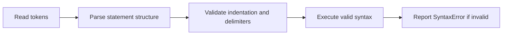

> **Level 1: Beginner** · Topic 4 of 35

[← IDE Setup](./03-ide-setup.md) · [↑ Level index](../README.md) · [Variables →](./05-variables.md)

# Python Syntax

## Overview
- **What is it?** Python syntax is the grammar that defines valid tokens, expressions, statements, indentation, and code blocks.
- **Why is it important?** Syntax determines how Python groups instructions; invalid grammar stops before the program can run.
- **Where is it used?** Every Python file, interactive command, function, class, and control-flow block follows these rules.

## Learning Objectives
- Use indentation and colons to form blocks.
- Distinguish expressions, statements, comments, and identifiers.
- Interpret a `SyntaxError` location and correct the grammar.

## Real World Applications
- Express business rules as readable blocks.
- Review code structure before runtime behavior.
- Create scripts that tools can parse consistently.

## Core Concepts

### Statements and expressions
- **Definition:** An expression produces a value; a statement performs an action such as assignment or import.
- **Visual explanation:** `tokens -> expression or statement -> parsed instruction`
- **Practical example:** The right side is an expression inside an assignment statement.

```python
total = 4 + 6
print(total)
```

### Indented blocks
- **Definition:** A colon starts a suite whose consistently indented statements belong to the preceding construct.
- **Visual explanation:** `header with colon -> indented suite -> next outer statement`
- **Practical example:** Only the indented print belongs to the `if` block.

```python
ready = True
if ready:
    print("Starting")
print("Finished")
```

### Names and comments
- **Definition:** Identifiers name program elements; comments begin with `#` and are ignored by the parser.
- **Visual explanation:** `identifier = expression  # explanation`
- **Practical example:** Valid snake_case names make statement roles visible.

```python
# Calculate the price after a discount.
base_price = 50
discounted_price = base_price * 0.8
print(discounted_price)
```

## Infographic Summary

| Infographic Block | Topic-Specific Takeaway |
| --- | --- |
| 📌 Concept | Python syntax is the grammar that defines valid tokens, expressions, statements, indentation, and code blocks. |
| ⚡ Purpose | Define the valid grammar and block structure that the Python interpreter can parse. |
| 🔥 Benefits | Syntax determines how Python groups instructions; invalid grammar stops before the program can run. |
| 🎯 Use Cases | Every Python file, interactive command, function, class, and control-flow block follows these rules. |
| 🚀 Best Practices | Indent with four spaces, close delimiters, and read syntax errors from the indicated line plus the line before it. |
| ❌ Common Mistakes | Confusing syntax rules with variable design: syntax permits `x`, but clear naming determines whether `x` communicates meaning. |

## Syntax Guide

### Basic Syntax

```python
course = "Python"
print(course)
```

### Standard Structure

```python
temperature = 18
if temperature < 20:
    print("Bring a jacket")
else:
    print("Light clothing is enough")
```

### Code Pattern

```python
def label_score(score):
    if score >= 90:
        return "excellent"
    return "developing"

print(label_score(94))
```

## Examples

### Beginner Example

```python
message = "Valid Python syntax"
print(message)
```

### Intermediate Example

```python
for number in range(3):
    square = number ** 2
    print(number, square)
```

### Advanced Example

```python
def shipping_cost(total, member=False):
    if member or total >= 75:
        return 0
    return 8

print(shipping_cost(54, member=True))
```

## Workflow Diagram



---

[← IDE Setup](./03-ide-setup.md) · [↑ Level index](../README.md) · [Variables →](./05-variables.md)
