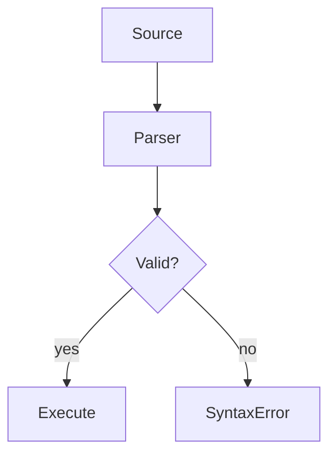

# Python Syntax

## Overview

- **What is it?** Python syntax defines how statements, blocks, and expressions are written.
- **Why is it important?** Correct syntax is required before logic, libraries, or frameworks matter.
- **Where is it used?** Every script, notebook cell, test file, and module.

## Learning Objectives

- **Skills gained:** Practical command of Python Syntax.
- **Concepts covered:**

- Use indentation, colons, and statement structure correctly.
- Write valid expressions and comments.
- Read tracebacks caused by syntax errors.

- **Expected outcome:** You write syntactically valid Python without constant SyntaxError failures.

## Real World Applications

- Application code
- Data notebooks
- Infrastructure scripts
- Test suites

- **Business applications:** Automate workflows, reduce manual errors, accelerate delivery.
- **Career relevance:** Required knowledge for Python roles from junior developer to senior engineer.

## Core Concepts

### Indentation

- **Definition:** Blocks are defined by consistent leading spaces.
- **Visual explanation:** `Indentation` → process → result
- **Practical example:**

```python
if True:
    print('indented')
```

### Colon Blocks

- **Definition:** Compound statements end with a colon.
- **Visual explanation:** `Colon Blocks` → process → result
- **Practical example:**

```python
for i in range(3):
    print(i)
```

### Comments

- **Definition:** Lines starting with # are ignored.
- **Visual explanation:** `Comments` → process → result
- **Practical example:**

```python
# comment
x = 1
print(x)
```

## Infographic Summary

| Block | Summary |
| --- | --- |
| 📌 Concept | Python uses significant whitespace and readable English keywords. |
| ⚡ Purpose | Express program structure clearly without braces. |
| 🔥 Benefits | Less boilerplate, enforced readability, quick to learn. |
| 🎯 Use Cases | Scripts, functions, classes, config loaders. |
| 🚀 Best Practices | 4 spaces per level, PEP 8 naming, one statement style per project. |
| ❌ Common Mistakes | Mixing tabs and spaces, missing colons, trailing comma confusion. |

## Syntax Guide

### Basic Syntax

```python
name = "Ada"
print(name)
```

### Standard Structure

```python
imports -> definitions -> main guard -> execution
```

### Code Pattern

```python
values = [1, 2, 3]
print([v * v for v in values])
```

## Examples

### Beginner Example

```python
message = "Syntax matters"
print(message)
```

### Intermediate Example

```python
print([v * v for v in [1, 2, 3, 4]])
```

### Advanced Example

```python
from typing import Iterator


def count(n: int) -> Iterator[int]:
    for i in range(n):
        yield i


print(list(count(4)))
```

## Workflow Diagram



---
