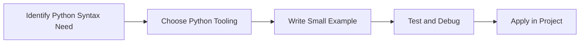

> **Level 1: Beginner** · Topic 4 of 35

[← IDE Setup](./03-ide-setup.md) · [↑ Level index](../README.md) · [Variables →](./05-variables.md)

# Python Syntax

## Overview
- **What is it?** Python syntax is the set of grammar rules for indentation, expressions, statements, comments, imports, functions, and blocks.
- **Why is it important?** Make code understandable to both Python and other developers.
- **Where is it used?** Learning labs, team onboarding, automation, and product engineering.

## Learning Objectives
- Gain the practical skill to explain, write, debug, and review python syntax code.
- Cover the vocabulary, syntax, workflow, edge cases, and professional habits behind python syntax.
- Expected outcome: you can use python syntax in a small project and recognize when it belongs in production code.

## Real World Applications
- **Industry use cases:** Learning labs, team onboarding, automation, and product engineering.
- **Business applications:** Reduce manual work, improve reliability, support reporting, automate decisions, and ship maintainable features.
- **Career relevance:** Supports Python developer, backend engineer, data engineer, AI engineer, DevOps engineer, QA automation, and cybersecurity automation roles.

## Core Concepts

### Mental Model
- **Definition:** The main idea that gives python syntax its structure and purpose inside a Python program.
- **Visual explanation:** `problem -> Python Syntax model -> clear code`
- **Practical example:**

```python
apply_python_syntax_label = "Python Syntax"
print(apply_python_syntax_label)
```

### Execution Flow
- **Definition:** The ordered steps Python follows when python syntax code is created, executed, or integrated.
- **Visual explanation:** `input -> Python operation -> result -> feedback`
- **Practical example:**

```python
score = 10
print(score)
```

### Quality Rule
- **Definition:** The reliability habit that keeps python syntax understandable, testable, secure, and maintainable.
- **Visual explanation:** `working code -> validation -> production confidence`
- **Practical example:**

```python
price = 120
discount_rate = 0.15
final_price = price * (1 - discount_rate)
print(final_price)
```

## Infographic Summary

| Infographic Block | Key Message |
| --- | --- |
| 📌 Concept | Python Syntax belongs to the fundamental Python practice part of Python mastery. |
| ⚡ Purpose | Make code understandable to both Python and other developers. |
| 🔥 Benefits | Readable structure, fewer parser errors, and consistent team conventions. |
| 🎯 Use Cases | Learning labs, team onboarding, automation, and product engineering. |
| 🚀 Best Practices | Prefer readable names, small examples, explicit errors, tests, documentation, and version-aware choices. |
| ❌ Common Mistakes | Copying code without understanding it, ignoring edge cases, skipping validation, and mixing unrelated responsibilities. |

## Syntax Guide

### Basic Syntax

```python
customer_name = "Amina"
order_total = 149.50
is_paid = False
```

### Standard Structure

```python
def apply_python_syntax(value):
    """Apply the Python Syntax concept to one value."""
    return value

result = apply_python_syntax("practice")
print(result)
```

### Code Pattern

```python
# 1. Identify the Python Syntax problem
# 2. Apply the correct Python structure
# 3. Validate the result with tests or output
```

## Examples

### Beginner Example

```python
score = 10
print(score)
```

### Intermediate Example

```python
price = 120
discount_rate = 0.15
final_price = price * (1 - discount_rate)
print(final_price)
```

### Advanced Example

```python
from dataclasses import dataclass

@dataclass(frozen=True)
class Metric:
    name: str
    value: float

conversion_rate = Metric("conversion_rate", 0.084)
print(conversion_rate)
```

## Workflow Diagram




---

---

[← IDE Setup](./03-ide-setup.md) · [↑ Level index](../README.md) · [Variables →](./05-variables.md)
