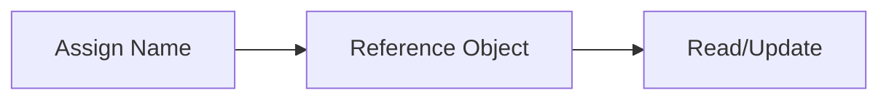

# Variables

## Overview

- **What is it?** Variables are names that reference objects stored in memory.
- **Why is it important?** They let programs remember state and transform data over time.
- **Where is it used?** Every Python program from scripts to ML pipelines.

## Learning Objectives

- **Skills gained:** Practical command of Variables.
- **Concepts covered:**

- Assign and reassign variables correctly.
- Follow PEP 8 naming conventions.
- Distinguish names from object identity.

- **Expected outcome:** You model program state with clear, consistent variable names.

## Real World Applications

- Business logic
- ETL transforms
- Game state
- Financial models

- **Business applications:** Automate workflows, reduce manual errors, accelerate delivery.
- **Career relevance:** Required knowledge for Python roles from junior developer to senior engineer.

## Core Concepts

### Assignment

- **Definition:** Binds a name to an object.
- **Visual explanation:** `Assignment` → process → result
- **Practical example:**

```python
score = 100
print(score)
```

### Rebinding

- **Definition:** A name can refer to a new object.
- **Visual explanation:** `Rebinding` → process → result
- **Practical example:**

```python
score = score + 10
print(score)
```

### snake_case

- **Definition:** Standard style for variable names.
- **Visual explanation:** `snake_case` → process → result
- **Practical example:**

```python
user_email = 'a@b.com'
print(user_email)
```

## Infographic Summary

| Block | Summary |
| --- | --- |
| 📌 Concept | Variables label objects; they are not typed boxes. |
| ⚡ Purpose | Store and update program data. |
| 🔥 Benefits | Readable code, reusable values, easier debugging. |
| 🎯 Use Cases | Counters, configs, user input, API payloads. |
| 🚀 Best Practices | Descriptive names, avoid shadowing builtins, init before use. |
| ❌ Common Mistakes | Reusing names for different concepts, mutating shared references unexpectedly. |

## Syntax Guide

### Basic Syntax

```python
name = 'Ada'
age = 36
```

### Standard Structure

```python
# declare -> use -> update
```

### Code Pattern

```python
total = price * quantity
print(total)
```

## Examples

### Beginner Example

```python
x = 5
y = 3
print(x + y)
```

### Intermediate Example

```python
first, second, *rest = [1, 2, 3, 4, 5]
print(first, second, rest)
```

### Advanced Example

```python
from typing import Final

MAX_RETRIES: Final = 3
attempts = 0
while attempts < MAX_RETRIES:
    attempts += 1
print(attempts)
```

## Workflow Diagram



---
