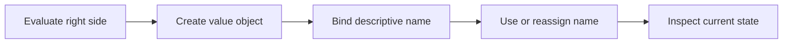

> **Level 1: Beginner** · Topic 5 of 35

[← Python Syntax](./04-python-syntax.md) · [↑ Level index](../README.md) · [Data Types →](./06-data-types.md)

# Variables

## Overview
- **What is it?** A variable is a name bound to a Python object; assignment changes which object that name references.
- **Why is it important?** Meaningful names let programs retain and update state without repeating literal values.
- **Where is it used?** Variables represent measurements, configuration, user state, counters, and intermediate results.

## Learning Objectives
- Create and reassign names with `=`.
- Choose descriptive snake_case identifiers and constants by convention.
- Explain aliasing when two names refer to the same mutable object.

## Real World Applications
- Track an order total or game score.
- Store configuration used by several statements.
- Name intermediate calculations for review and debugging.

## Core Concepts

### Name binding
- **Definition:** Assignment evaluates the right side, then binds the resulting object to the name on the left.
- **Visual explanation:** `expression -> object <- variable name`
- **Practical example:** The name describes the value used later.

```python
lesson_count = 35
print(lesson_count)
```

### Reassignment
- **Definition:** Reassignment points an existing name at a new object; it does not edit the old immutable value.
- **Visual explanation:** `score -> 10, then score -> 15`
- **Practical example:** A counter is rebound after addition.

```python
score = 10
score = score + 5
print(score)
```

### Aliasing mutable data
- **Definition:** Assigning one list name to another copies the reference, so mutation through either name affects one list.
- **Visual explanation:** `first -> list object <- second`
- **Practical example:** Appending through the alias changes the shared object.

```python
primary = ["red", "blue"]
alias = primary
alias.append("green")
print(primary)
```

## Infographic Summary

| Infographic Block | Topic-Specific Takeaway |
| --- | --- |
| 📌 Concept | A variable is a name bound to a Python object; assignment changes which object that name references. |
| ⚡ Purpose | Bind meaningful names to values so program state can be read, reused, and updated. |
| 🔥 Benefits | Meaningful names let programs retain and update state without repeating literal values. |
| 🎯 Use Cases | Variables represent measurements, configuration, user state, counters, and intermediate results. |
| 🚀 Best Practices | Name values by purpose, initialize them near first use, and copy mutable data when independent state is required. |
| ❌ Common Mistakes | Assuming `alias = original` creates an independent copy of a list. |

## Syntax Guide

### Basic Syntax

```python
student_name = "Noor"
completed_lessons = 4
```

### Standard Structure

```python
unit_price = 12.50
quantity = 3
subtotal = unit_price * quantity
print(subtotal)
```

### Code Pattern

```python
items = ["book", "pen"]
backup = items.copy()
items.append("paper")
print(items, backup)
```

## Examples

### Beginner Example

```python
city = "Lagos"
print(city)
```

### Intermediate Example

```python
balance = 100
withdrawal = 35
balance -= withdrawal
print(balance)
```

### Advanced Example

```python
cart = {"items": 3, "subtotal": 48.0}
tax_rate = 0.075
tax = cart["subtotal"] * tax_rate
grand_total = cart["subtotal"] + tax
print(f"${grand_total:.2f}")
```

## Workflow Diagram



---

[← Python Syntax](./04-python-syntax.md) · [↑ Level index](../README.md) · [Data Types →](./06-data-types.md)
