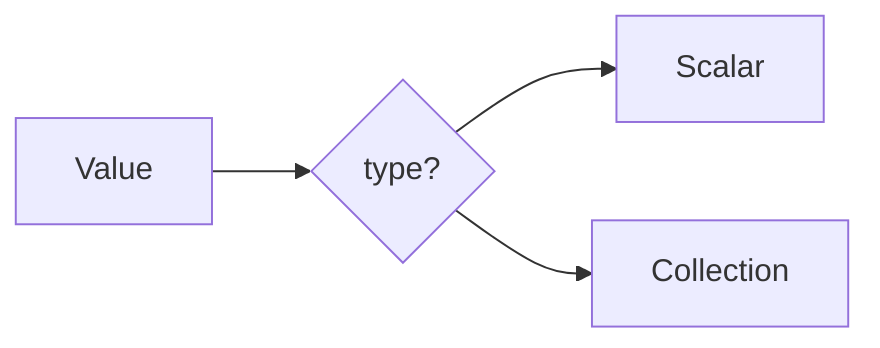

# Data Types

## Overview

- **What is it?** Python data types classify values such as numbers, text, collections, and booleans.
- **Why is it important?** Choosing the right type prevents logic bugs and enables efficient operations.
- **Where is it used?** Validation, APIs, analytics, configuration, and user input handling.

## Learning Objectives

- **Skills gained:** Practical command of Data Types.
- **Concepts covered:**

- Identify built-in scalar and collection types.
- Inspect types with type() and isinstance().
- Select appropriate types for domain data.

- **Expected outcome:** You pick and verify types confidently in everyday Python code.

## Real World Applications

- Backend APIs
- Data science
- Finance systems
- IoT telemetry

- **Business applications:** Automate workflows, reduce manual errors, accelerate delivery.
- **Career relevance:** Required knowledge for Python roles from junior developer to senior engineer.

## Core Concepts

### int

- **Definition:** Whole numbers without fractional part.
- **Visual explanation:** `int` → process → result
- **Practical example:**

```python
count = 42
print(type(count))
```

### float

- **Definition:** Numbers with decimal precision.
- **Visual explanation:** `float` → process → result
- **Practical example:**

```python
price = 19.99
print(round(price, 2))
```

### bool

- **Definition:** True/False logical values.
- **Visual explanation:** `bool` → process → result
- **Practical example:**

```python
active = True
print(active and False)
```

## Infographic Summary

| Block | Summary |
| --- | --- |
| 📌 Concept | Types describe what operations are valid on a value. |
| ⚡ Purpose | Model real-world data with the correct Python objects. |
| 🔥 Benefits | Safer code, clearer APIs, better performance choices. |
| 🎯 Use Cases | User profiles, sensor readings, cart totals, feature flags. |
| 🚀 Best Practices | Prefer isinstance over type(); document expected types. |
| ❌ Common Mistakes | Confusing None checks, bool/int coercion surprises. |

## Syntax Guide

### Basic Syntax

```python
age = 30
name = 'Ada'
active = True
```

### Standard Structure

```python
scalar -> collection -> inspect -> convert when needed
```

### Code Pattern

```python
print(isinstance(3.14, float))
```

## Examples

### Beginner Example

```python
print(type(3.14))
print(isinstance(3.14, float))
```

### Intermediate Example

```python
from typing import Any

def describe(value: Any) -> str:
    return f"{value!r} is {type(value).__name__}"


print(describe([1, 2]))
```

### Advanced Example

```python
from dataclasses import dataclass


@dataclass
class Reading:
    sensor_id: str
    value: float
    ok: bool


print(Reading("temp-1", 22.5, True))
```

## Workflow Diagram



---
