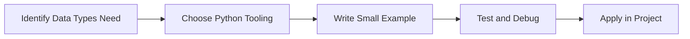

> **Level 1: Beginner** · Topic 6 of 35

[← Variables](./05-variables.md) · [↑ Level index](../README.md) · [Type Casting →](./07-type-casting.md)

# Data Types

## Overview
- **What is it?** Data types classify values such as numbers, text, booleans, sequences, mappings, and None.
- **Why is it important?** Choose operations that match the kind of value being processed.
- **Where is it used?** Software teams, education, automation, analytics, and backend development.

## Learning Objectives
- Gain the practical skill to explain, write, debug, and review data types code.
- Cover the vocabulary, syntax, workflow, edge cases, and professional habits behind data types.
- Expected outcome: you can use data types in a small project and recognize when it belongs in production code.

## Real World Applications
- **Industry use cases:** Software teams, education, automation, analytics, and backend development.
- **Business applications:** Reduce manual work, improve reliability, support reporting, automate decisions, and ship maintainable features.
- **Career relevance:** Supports Python developer, backend engineer, data engineer, AI engineer, DevOps engineer, QA automation, and cybersecurity automation roles.

## Core Concepts

### Mental Model
- **Definition:** The main idea that gives data types its structure and purpose inside a Python program.
- **Visual explanation:** `problem -> Data Types model -> clear code`
- **Practical example:**

```python
apply_data_types_label = "Data Types"
print(apply_data_types_label)
```

### Execution Flow
- **Definition:** The ordered steps Python follows when data types code is created, executed, or integrated.
- **Visual explanation:** `input -> Python operation -> result -> feedback`
- **Practical example:**

```python
value = 42
print(type(value).__name__)
```

### Quality Rule
- **Definition:** The reliability habit that keeps data types understandable, testable, secure, and maintainable.
- **Visual explanation:** `working code -> validation -> production confidence`
- **Practical example:**

```python
profile = {"name": "Noor", "skills": ["Python", "SQL"], "active": True}
print(profile["skills"][0])
```

## Infographic Summary

| Infographic Block | Key Message |
| --- | --- |
| 📌 Concept | Data Types belongs to the core programming foundation part of Python mastery. |
| ⚡ Purpose | Choose operations that match the kind of value being processed. |
| 🔥 Benefits | Correct calculations, validation, serialization, and storage. |
| 🎯 Use Cases | Software teams, education, automation, analytics, and backend development. |
| 🚀 Best Practices | Prefer readable names, small examples, explicit errors, tests, documentation, and version-aware choices. |
| ❌ Common Mistakes | Copying code without understanding it, ignoring edge cases, skipping validation, and mixing unrelated responsibilities. |

## Syntax Guide

### Basic Syntax

```python
age = 31
price = 19.99
name = "Python"
is_active = True
missing = None
```

### Standard Structure

```python
def apply_data_types(value):
    """Apply the Data Types concept to one value."""
    return value

result = apply_data_types("practice")
print(result)
```

### Code Pattern

```python
# 1. Identify the Data Types problem
# 2. Apply the correct Python structure
# 3. Validate the result with tests or output
```

## Examples

### Beginner Example

```python
value = 42
print(type(value).__name__)
```

### Intermediate Example

```python
profile = {"name": "Noor", "skills": ["Python", "SQL"], "active": True}
print(profile["skills"][0])
```

### Advanced Example

```python
from typing import TypedDict

class User(TypedDict):
    id: int
    email: str

user: User = {"id": 1, "email": "dev@example.com"}
print(user)
```

## Workflow Diagram




---

---

[← Variables](./05-variables.md) · [↑ Level index](../README.md) · [Type Casting →](./07-type-casting.md)
